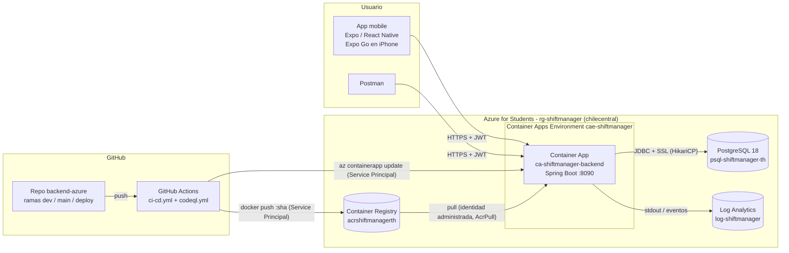

# Arquitectura

## Vista general



## Tecnologías y versiones

| Capa | Tecnología | Versión |
|---|---|---|
| Lenguaje / runtime | Java (Eclipse Temurin) | 21 |
| Framework | Spring Boot (web, data-jpa, security, validation, actuator) | 3.5.16 |
| Build | Gradle (wrapper) | el del repositorio |
| Seguridad | Spring Security + JWT (jjwt) + BCrypt | jjwt 0.12.6 |
| Persistencia | Hibernate / Spring Data JPA, HikariCP, Flyway | gestionados por Spring Boot |
| Base de datos | PostgreSQL (Azure Database for PostgreSQL Flexible Server, B1ms); H2 en memoria para desarrollo y tests | 18 |
| Documentación API | springdoc-openapi (Swagger UI) | 2.8.17 |
| Imagen | `gcr.io/distroless/java21-debian13:nonroot` | — |
| Contenedores local | Docker Desktop, Docker Compose | 29.8 / v5.6 |
| CI/CD | GitHub Actions (checkout v7, setup-java v6, setup-gradle v6, azure/login v3, anchore/scan-action v7, codeql-action v4) | — |
| Seguridad | Grype 0.120.1, Trivy 0.76.0 (comparación), CodeQL 2.27.2, gitleaks | — |
| Nube | Azure Container Apps (Consumption), Azure Container Registry (Basic), Log Analytics, Azure Monitor | — |
| Mobile | Expo SDK 57, React Native 0.86, expo-router, TypeScript, expo-secure-store | — |

## Backend por capas

```mermaid
flowchart TB
    REQ[Petición HTTP] --> F[JwtAuthenticationFilter<br/>valida el token]
    F --> SEC[SecurityFilterChain<br/>reglas por ruta y rol]
    SEC --> C[Controllers<br/>@RestController]
    C --> S[Services<br/>@Service @Transactional<br/>reglas de negocio]
    S --> R[Repositories<br/>Spring Data JPA]
    R --> H[HikariCP] --> DB[(PostgreSQL)]
    C -.errores.-> EH[GlobalExceptionHandler]
```

| Paquete | Contenido |
|---|---|
| `config` | `SecurityConfig`, `OpenApiConfig`, `DataSeeder` (admin), `DemoDataSeeder` (datos de ejemplo) |
| `security` | `JwtService`, `JwtAuthenticationFilter`, `AppUserDetailsService`, `SecurityUser` |
| `controller` | Auth, Guards, Services, ShiftAssignments, Reports, Users, Greeting |
| `service` | Lógica de negocio (turnos superpuestos, horas trabajadas, reportes) |
| `repository` | Interfaces Spring Data JPA con consultas JPQL parametrizadas |
| `model` / `dto` | Entidades JPA y objetos de entrada/salida |
| `exception` | `GlobalExceptionHandler` |

## Configuración por entorno

| Entorno | Perfil | Base | Cómo se configura |
|---|---|---|---|
| Desarrollo / tests | (ninguno) | H2 en memoria | Valores por defecto de `application.properties` |
| PostgreSQL local | `postgres` | PostgreSQL | Variables con valores por defecto de desarrollo |
| Docker Compose | `prod` | PostgreSQL 18 (contenedor) | `.env` (no versionado) |
| Azure | `prod` | Azure PostgreSQL 18 | Variables y secrets de la Container App |

## Archivos creados y modificados (backend)

| Archivo | Estado | Para qué |
|---|---|---|
| `shiftmanager/build.gradle` | Modificado | Actuator, build info, Spring Boot 3.5.16 y parches de seguridad |
| `shiftmanager/src/main/resources/application.properties` | Modificado | HikariCP, Actuator, graceful shutdown, `JWT_EXPIRATION_MS` |
| `shiftmanager/src/main/resources/application-prod.properties` | Nuevo | Perfil de producción sin valores por defecto para secretos; access log |
| `shiftmanager/src/main/java/.../config/SecurityConfig.java` | Modificado | Reglas para Actuator y `/api/auth/me` |
| `shiftmanager/src/main/java/.../security/JwtAuthenticationFilter.java` | Modificado | Rechaza tokens de usuarios desactivados o inexistentes |
| `shiftmanager/src/main/java/.../controller/AuthController.java` | Modificado | `/api/auth/me`, validación, logs, 503 si la base no responde |
| `shiftmanager/src/main/java/.../config/DataSeeder.java`, `DemoDataSeeder.java` | Modificados | Orden de los seeders y admin garantizado |
| `shiftmanager/Dockerfile`, `.dockerignore`, `docker/HealthCheck.java` | Modificados / nuevo | Imagen distroless, capas, OCI, health check |
| `docker-compose.yml`, `.env.example` | Modificados | Entorno local con red interna y health checks |
| `.github/workflows/ci-cd.yml` | Nuevo (reemplaza `ci.yml`) | CI/CD con Grype y deploy condicionado |
| `.github/workflows/codeql.yml` | Nuevo | Análisis estático |
| `scripts/azure_manager.py` | Nuevo | Operación manual de Azure (reemplaza `script_az.py`) |
| `shiftmanager/src/test/.../ActuatorAccessTest.java`, `AuthSecurityTest.java`, `DataSeederTest.java` | Nuevos | Tests de Actuator, JWT y seeders (33 tests en total) |
| `docs/*.md`, `docs/postman/*`, `docs/reports/*` | Nuevos | Documentación, colección de Postman e informes de Grype |

En la app mobile: `eas.json`, `.env.example`, `lib/api.ts` (timeout y mensajes) y `README.md`.

## Qué se tomó del proyecto de la cursada (goat-grup-one) y qué no

| Elemento de goat-grup-one | En este proyecto |
|---|---|
| Dockerfile multietapa con distroless `static` | Adaptado: JDK para compilar, distroless **Java 21** para ejecutar, usuario sin privilegios, capas del jar |
| `docker-compose.yml` de un servicio | Adaptado: backend + PostgreSQL, red interna, volumen, health checks, variables obligatorias |
| `build-and-push.yml` (SP, `az acr login`, tags `:sha` y `:latest`, deploy con `/notdeploy` en el mensaje del commit) | Adaptado: tests con Gradle, Grype, sin `latest`, deploy por **rama** o **ejecución manual** (más explícito y fácil de demostrar), verificación de la versión desplegada |
| `script_az.py` (1425 líneas, tag desde `.env`) | Reescrito en `scripts/azure_manager.py` (~390 líneas), con el tag desde git igual que CI |
| Login con Service Principal desde `.env` | Igual (opción `--sp`), con credenciales fuera del repositorio y permisos mínimos |
| Usuario admin del ACR como credencial del registro | No: la Container App usa identidad administrada (`AcrPull`) y el admin del ACR está desactivado |
| Binario compilado commiteado | No corresponde |
