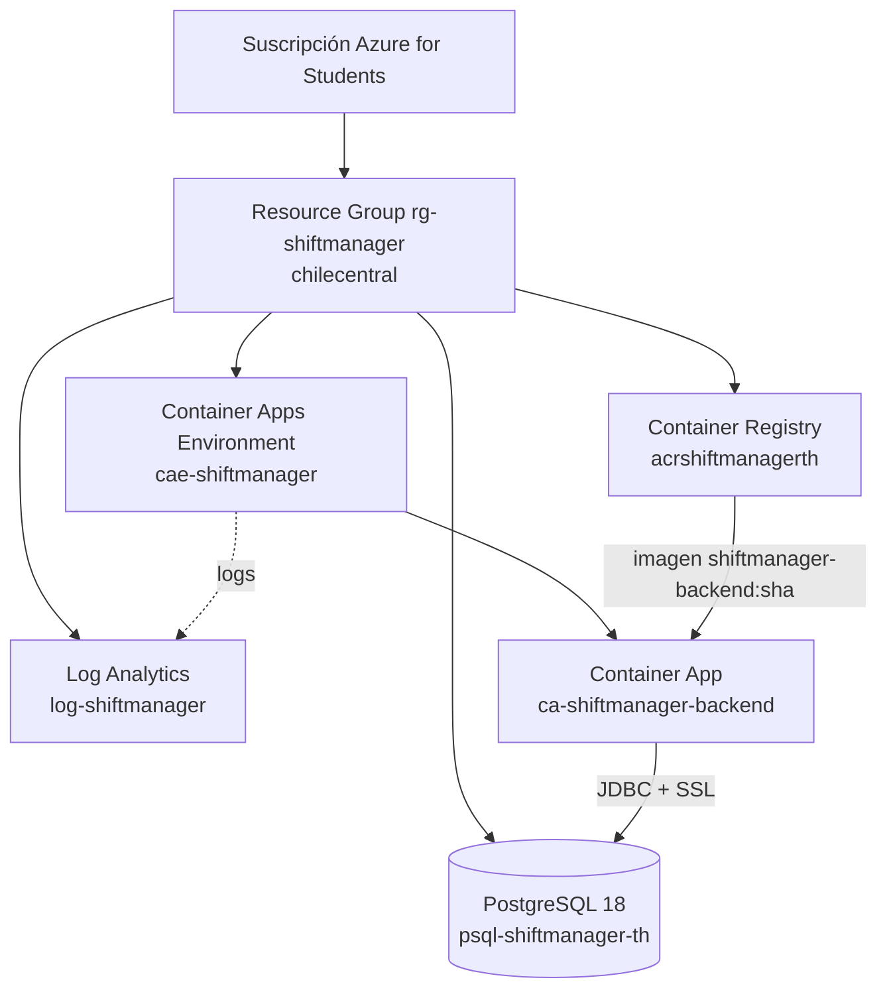
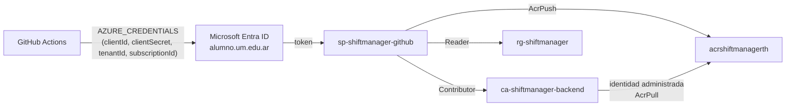

# Azure

Infraestructura del backend en Microsoft Azure, con la guía para crearla desde el **Portal** o desde la **CLI** y para eliminarla al terminar.

## Recursos

| Recurso | Nombre | Configuración |
|---|---|---|
| Suscripción | Azure for Students | Directorio `alumno.um.edu.ar`. Política de la universidad: solo regiones `chilecentral`, `brazilsouth`, `mexicocentral`, `canadacentral`, `southafricanorth` |
| Resource Group | `rg-shiftmanager` | Región `chilecentral` (Santiago, la más cercana a Mendoza) |
| Azure Container Registry | `acrshiftmanagerth` (`acrshiftmanagerth.azurecr.io`) | SKU Basic, **usuario admin desactivado** |
| Log Analytics | `log-shiftmanager` | Retención 30 días |
| Container Apps Environment | `cae-shiftmanager` | Plan de consumo, logs enviados a `log-shiftmanager` |
| Container App | `ca-shiftmanager-backend` | Ver [Fase 9](#despliegue-manual) |
| PostgreSQL Flexible Server | `psql-shiftmanager-th` (`psql-shiftmanager-th.postgres.database.azure.com`) | PostgreSQL 18, Burstable B1ms, 32 GB, backups 7 días, SSL obligatorio, `max_connections` = 50, base `shiftmanager` |
| Service Principal | `sp-shiftmanager-github` | Ver [Service Principal](#service-principal) |



- **Subscription → Resource Group → ACR → imagen**: la suscripción es la cuenta que paga; el resource group agrupa los recursos del proyecto; el ACR vive dentro del resource group y guarda las imágenes versionadas.
- **Container Apps Environment → Container App → Spring Boot**: el environment es el entorno administrado (red, logs) donde corren las apps; la Container App ejecuta la imagen del backend y le da una URL HTTPS.

## Costos y cómo evitarlos

| Recurso | Costo aproximado | Cómo evitar gastos |
|---|---|---|
| ACR Basic | ~0,17 USD por día (~5 USD/mes), fijo | Borrar imágenes viejas; eliminar el resource group al terminar |
| Log Analytics | Gratis hasta 5 GB/mes | Retención de 30 días; la app genera pocos logs |
| Container Apps | Gratis dentro de la cuota mensual (180.000 vCPU-s, 360.000 GiB-s, 2 millones de peticiones) | Réplicas mínimas en 0 fuera de las demos |
| PostgreSQL B1ms | ~13-17 USD/mes si no lo cubre el beneficio de 12 meses de servicios gratis | Detenerlo cuando no se usa (ver [Operación](#operación-de-la-base)) |

Para ver el crédito restante: https://www.microsoftazuresponsorships.com/balance. Para ver qué servicios gratis incluye la cuenta: Portal → buscar **Free services**.

## Requisitos previos

1. **Azure CLI** (Windows): `winget install -e --id Microsoft.AzureCLI`. Cerrar y volver a abrir la terminal (o VS Code) para que aparezca `az`.
2. **Iniciar sesión**: `az login` (abre el navegador; elegir la suscripción "Azure for Students").
3. **Extensión de Container Apps**: `az extension add -n containerapp --upgrade`.
4. **Registrar los proveedores** (una sola vez por suscripción, gratis):

```powershell
az provider register -n Microsoft.App --wait
az provider register -n Microsoft.ContainerRegistry --wait
az provider register -n Microsoft.DBforPostgreSQL --wait
az provider register -n Microsoft.OperationalInsights --wait
```

Verificar: `az provider show -n Microsoft.App --query registrationState` → `"Registered"`.

Comprobar regiones permitidas por la política de la universidad: `az policy assignment list --query "[].parameters"`.

## Creación paso a paso

Todos los comandos son para **PowerShell**. Variables usadas:

```powershell
$RG = "rg-shiftmanager"
$LOC = "chilecentral"
$ACR = "acrshiftmanagerth"          # único en todo Azure, solo minúsculas y números
$PG = "psql-shiftmanager-th"        # único en todo Azure
```

### 1. Resource Group

**Portal**: https://portal.azure.com → buscador **Resource groups** → **+ Create** → Subscription: *Azure for Students*; Resource group: `rg-shiftmanager`; Region: *(South America) Chile Central* → **Review + create** → **Create**.

**CLI**:

```powershell
az group create -n $RG -l $LOC --tags proyecto=shiftmanager materia=isa
```

Verificar: `az group show -n $RG --query properties.provisioningState` → `"Succeeded"`.

### 2. Log Analytics

**Portal**: buscador **Log Analytics workspaces** → **+ Create** → Resource group `rg-shiftmanager`, Name `log-shiftmanager`, Region *Chile Central* → **Review + create** → **Create**. Después: el workspace → **Usage and estimated costs** → **Data Retention** → 30 días.

**CLI**:

```powershell
az monitor log-analytics workspace create -g $RG -n log-shiftmanager -l $LOC --retention-time 30 --sku PerGB2018
```

### 3. Azure Container Registry

**Portal**: buscador **Container registries** → **+ Create** → Resource group `rg-shiftmanager`, Registry name `acrshiftmanagerth`, Location *Chile Central*, Pricing plan **Basic** → **Review + create** → **Create**. En el registro creado → **Settings → Access keys**: dejar **Admin user** desactivado.

**CLI**:

```powershell
az acr check-name -n $ACR                     # nameAvailable: true
az acr create -g $RG -n $ACR -l $LOC --sku Basic --admin-enabled false
```

Verificar: `az acr show -n $ACR --query "{servidor:loginServer, admin:adminUserEnabled}"`.

> El usuario admin queda desactivado: GitHub Actions entra con el Service Principal y la Container App descarga las imágenes con su identidad administrada. No hay una contraseña compartida del registro.

### 4. Container Apps Environment

**Portal**: buscador **Container Apps Environments** → **+ Create** → Resource group `rg-shiftmanager`, Name `cae-shiftmanager`, Region *Chile Central*, Environment type **Consumption only** → pestaña **Monitoring**: Logs destination **Azure Log Analytics**, workspace `log-shiftmanager` → **Review + create** → **Create**.

**CLI**:

```powershell
$wsId  = az monitor log-analytics workspace show -g $RG -n log-shiftmanager --query customerId -o tsv
$wsKey = az monitor log-analytics workspace get-shared-keys -g $RG -n log-shiftmanager --query primarySharedKey -o tsv
az containerapp env create -g $RG -n cae-shiftmanager -l $LOC --environment-mode ConsumptionOnly `
  --logs-destination log-analytics --logs-workspace-id $wsId --logs-workspace-key $wsKey
```

Verificar: `az containerapp env show -g $RG -n cae-shiftmanager --query "{modo:properties.environmentMode, estado:properties.provisioningState}"` → `ConsumptionOnly`, `Succeeded`.

> **`--environment-mode ConsumptionOnly` es obligatorio**: la CLI actual crea por defecto un environment en modo `Express`, que no permite que la Container App descargue imágenes del ACR con su identidad administrada (error `ExpressEnvironmentFeatureNotSupported`). El modo de un environment no se puede cambiar: si se creó como Express hay que borrarlo (sin apps adentro) y crearlo de nuevo.

### 5. PostgreSQL Flexible Server

La contraseña del administrador se genera localmente y se guarda en `%USERPROFILE%\.shiftmanager\azure-secrets.env` (fuera del repositorio, con permisos solo para el usuario). Nunca se escribe en el código, el README ni el chat.

**Portal**: buscador **Azure Database for PostgreSQL flexible servers** → **+ Create** →
- Resource group `rg-shiftmanager`, Server name `psql-shiftmanager-th`, Region *Chile Central*, PostgreSQL version **18**.
- Workload type: **Development** → **Configure server**: Compute tier **Burstable**, size **Standard_B1ms**, Storage **32 GiB**, Storage autogrow desactivado, High availability desactivado.
- Authentication: **PostgreSQL authentication only**; Admin username `shiftadmin`; Password: el valor de `DB_PASSWORD` del archivo de secretos.
- Pestaña **Networking**: Connectivity method **Public access**; marcar **Allow public access from any Azure service within Azure to this server**. No agregar la IP propia salvo que se quiera conectar desde la PC.
- **Review + create** → **Create** (5-10 minutos).
- Después: el servidor → **Databases** → **+ Add** → `shiftmanager`.

**CLI**:

```powershell
# Lee los secretos del archivo local sin mostrarlos
$s = @{}; Get-Content "$env:USERPROFILE\.shiftmanager\azure-secrets.env" | Where-Object { $_ -match '^[A-Z_]+=' } |
  ForEach-Object { $k, $v = $_ -split '=', 2; $s[$k] = $v }

az postgres flexible-server create -g $RG -n $PG -l $LOC --version 18 `
  --tier Burstable --sku-name Standard_B1ms --storage-size 32 --storage-auto-grow Disabled `
  --backup-retention 7 --admin-user $s.DB_USERNAME --admin-password $s.DB_PASSWORD `
  --public-access 0.0.0.0 --yes
az postgres flexible-server db create -g $RG --server-name $PG --name shiftmanager
```

`--public-access 0.0.0.0` crea la regla de firewall que admite conexiones solo desde servicios de Azure.

Verificar:

```powershell
az postgres flexible-server show -g $RG -n $PG --query "{host:fullyQualifiedDomainName, estado:state, version:version}"
az postgres flexible-server db list -g $RG --server-name $PG --query "[].name"
az postgres flexible-server parameter show -g $RG --server-name $PG --name require_secure_transport --query value   # "on"
```

> **Decisión de seguridad**: la base usa acceso público restringido a servicios de Azure, con SSL obligatorio y una contraseña aleatoria larga. La opción más segura sería una red privada (VNet) entre Container Apps y PostgreSQL, pero agrega costo y complejidad que no se justifican en este proyecto. Queda como riesgo aceptado y documentado.

**Errores posibles**

| Error | Causa | Solución |
|---|---|---|
| `RequestDisallowedByPolicy` | Región no permitida por la universidad | Usar una de las 5 regiones permitidas |
| `MissingSubscriptionRegistration` | Proveedor no registrado | `az provider register -n <proveedor> --wait` |
| `AlreadyExists` / nombre no disponible | El nombre del ACR o del servidor ya existe en Azure | Cambiar el sufijo |
| `unrecognized arguments` | La CLI cambió un parámetro | `az <comando> --help` y actualizar la CLI (`az upgrade`) |

### Operación de la base

| Acción | Comando | Consecuencia |
|---|---|---|
| Detener (deja de cobrar cómputo) | `az postgres flexible-server stop -g $RG -n $PG` | La app no puede conectarse (readiness DOWN). Azure la vuelve a iniciar sola a los 7 días |
| Iniciar | `az postgres flexible-server start -g $RG -n $PG` | Vuelve en 1-3 minutos; la app se recupera sola |
| Estado | `az postgres flexible-server show -g $RG -n $PG --query state` | `Ready` / `Stopped` |

## Eliminar todo al terminar

```powershell
az group delete -n rg-shiftmanager --yes     # borra ACR, imágenes, base, logs y la Container App (irreversible)
```

Portal: **Resource groups** → `rg-shiftmanager` → **Delete resource group** → escribir el nombre → **Delete**.

El Service Principal no está dentro del resource group y se borra aparte (ver [Service Principal](#service-principal)).

## Service Principal

### Qué es y para qué lo usamos

Un **Service Principal** es una identidad de Azure para una aplicación (no para una persona): tiene un *Client ID* (usuario), un *Client Secret* (contraseña) y pertenece al directorio (*Tenant*). Se le asignan roles sobre recursos concretos, igual que a un usuario.

Lo usa **GitHub Actions** para entrar a Azure sin la cuenta personal: con él se autentica (`azure/login`), hace `az acr login` + `docker push` al ACR y actualiza la imagen de la Container App.



| Dato | Qué es | Dónde se ve |
|---|---|---|
| Client ID (appId) | Identificador del SP | Portal → **Microsoft Entra ID** → **App registrations** → *All applications* → `sp-shiftmanager-github` → *Overview* |
| Tenant ID | Directorio de la universidad | Mismo lugar (*Directory (tenant) ID*) o `az account show --query tenantId` |
| Subscription ID | Suscripción Azure for Students | Portal → **Subscriptions**, o `az account show --query id` |
| Client Secret | Contraseña del SP | Solo se muestra al crearlo; no se puede volver a leer, solo regenerar |

Relación con la suscripción y el resource group: el SP no tiene ningún rol sobre la suscripción; sus permisos están limitados a recursos de `rg-shiftmanager`.

### Permisos mínimos

| Rol | Alcance | Para qué |
|---|---|---|
| `AcrPush` | ACR `acrshiftmanagerth` | Subir (y bajar) imágenes |
| `Contributor` | Container App `ca-shiftmanager-backend` | Desplegar una imagen nueva (nueva revisión) |
| `Reader` | Resource group `rg-shiftmanager` | Que `az login` encuentre la suscripción y `az acr login` resuelva el registro. Sin este rol el login falla con *"No subscriptions found"* |

Probado con el SP en una sesión aislada: puede hacer `docker push` al ACR, y Azure le rechaza detener la base de datos o crear un resource group (`AuthorizationFailed`).

### Crear el Service Principal

**CLI** (PowerShell; el JSON con el secreto va directo al secreto de GitHub sin mostrarse):

```powershell
$acrId = az acr show -n acrshiftmanagerth --query id -o tsv
$rgId  = az group show -n rg-shiftmanager --query id -o tsv

$json = az ad sp create-for-rbac --name sp-shiftmanager-github --role AcrPush --scopes $acrId --years 1 --json-auth
$c = $json | ConvertFrom-Json
($c | Select-Object clientId, clientSecret, subscriptionId, tenantId | ConvertTo-Json -Compress) |
  gh secret set AZURE_CREDENTIALS --repo HerreroT/security-shift-manager-backend-azure

az role assignment create --assignee $c.clientId --role Reader --scope $rgId
# Después de crear la Container App (Fase 9):
$appId = az containerapp show -g rg-shiftmanager -n ca-shiftmanager-backend --query id -o tsv
az role assignment create --assignee $c.clientId --role Contributor --scope $appId
```

Verificar: `az role assignment list --assignee <clientId> --all -o table`.

**Portal**:
1. **Microsoft Entra ID** → **App registrations** → **+ New registration** → Name `sp-shiftmanager-github` → *Accounts in this organizational directory only* → **Register**. Anotar *Application (client) ID* y *Directory (tenant) ID*.
2. En la app → **Certificates & secrets** → **+ New client secret** → descripción `github-actions`, vencimiento 12 meses → **Add**. Copiar el **Value** en ese momento (después no se vuelve a mostrar) y pegarlo directamente en GitHub (ver abajo), nunca en un archivo del repositorio.
3. Asignar roles: ACR `acrshiftmanagerth` → **Access control (IAM)** → **+ Add** → **Add role assignment** → rol **AcrPush** → *Members*: *User, group, or service principal* → **+ Select members** → buscar `sp-shiftmanager-github` → **Review + assign**. Repetir con **Reader** en el resource group y **Contributor** en la Container App.

**Errores posibles**: `Insufficient privileges to complete the operation` (el directorio no permite crear apps: pedir a un administrador); `No subscriptions found` al hacer login (falta el rol `Reader` en el resource group); `AuthorizationFailed` en el pipeline (falta el rol en el recurso que se quiere modificar, o la asignación tarda 1-2 minutos en propagarse).

**Renovar el secreto** (vence al año): `az ad sp credential reset --id <clientId> --years 1 --json-auth` → actualizar `AZURE_CREDENTIALS` en GitHub.

**Eliminar**: `az ad sp delete --id <clientId>` (Portal: *App registrations* → la app → **Delete**).

### Service Principal con secreto vs. OIDC

| | Service Principal + secreto (lo que usamos, visto en clase) | OIDC (federated credentials) |
|---|---|---|
| Qué guarda GitHub | `AZURE_CREDENTIALS` con un *client secret* | Solo `clientId`, `tenantId`, `subscriptionId` (no son secretos) |
| Cómo se autentica | Envía el secreto a Entra ID | GitHub emite un token firmado de corta duración para ese repo/rama y Azure lo valida contra una *federated credential* |
| Riesgo | Si el secreto se filtra, sirve desde cualquier lugar hasta que venza (1 año) | No hay secreto permanente que robar |
| Mantenimiento | Renovar el secreto antes de que venza | Ninguno |
| Workflow | `azure/login` con `creds:` | `azure/login` con `client-id`, `tenant-id`, `subscription-id` y `permissions: id-token: write` |

Se mantuvo el mecanismo de la cursada (secreto) porque es el que hay que demostrar; OIDC sería la mejora natural en un proyecto real.

## Secretos y configuración

Hay dos tipos de credenciales y **no se mezclan**:

| Tipo | Quién las usa | Dónde se guardan | Valores |
|---|---|---|---|
| Credenciales de despliegue | GitHub Actions | **GitHub Secrets** | `AZURE_CREDENTIALS` |
| Configuración no sensible del despliegue | GitHub Actions | **GitHub Variables** | `AZURE_RESOURCE_GROUP`, `ACR_NAME`, `ACR_LOGIN_SERVER`, `IMAGE_NAME`, `CONTAINER_APP_NAME`, `CONTAINER_APP_ENVIRONMENT` |
| Secretos de ejecución | Spring Boot en Azure | **Secrets de la Container App** (`db-password`, `jwt-secret`, `admin-password`), referenciados desde variables de entorno con `secretref:` | `DB_PASSWORD`, `JWT_SECRET`, `ADMIN_PASSWORD` |
| Configuración de ejecución | Spring Boot en Azure | Variables de entorno de la Container App | `SPRING_PROFILES_ACTIVE`, `DB_URL`, `DB_USERNAME`, `ADMIN_EMAIL`, `SEED_DEMO_DATA` |
| Copia local de los secretos | El script `scripts/azure_manager.py` | `%USERPROFILE%\.shiftmanager\azure-secrets.env` y `azure-sp.env` (fuera del repositorio, permisos solo para el usuario) | — |

GitHub nunca ve la contraseña de la base ni el secreto del JWT, y Spring Boot nunca ve las credenciales del Service Principal.

**Cargar Secrets y Variables en GitHub**

- Web: repositorio → **Settings** → **Secrets and variables** → **Actions** → pestaña **Secrets** → **New repository secret** (nombre `AZURE_CREDENTIALS`, valor = JSON del SP). Pestaña **Variables** → **New repository variable** para cada variable de la tabla.
- Terminal: `gh secret set AZURE_CREDENTIALS` (pide el valor sin mostrarlo) y `gh variable set ACR_NAME --body acrshiftmanagerth`. Verificar con `gh secret list` y `gh variable list` (los secretos muestran solo el nombre y la fecha).

**Por qué no Key Vault**: Key Vault sirve para centralizar secretos compartidos por varias aplicaciones, con rotación y auditoría. Con una sola app, los secrets de Container Apps (cifrados y no visibles desde el Portal una vez guardados) cubren la necesidad sin agregar otro recurso.
