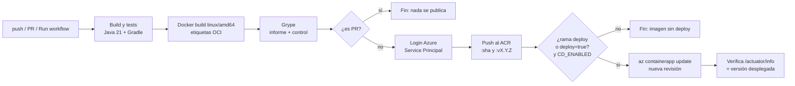

# CI/CD con GitHub Actions

Archivo: `.github/workflows/ci-cd.yml`. Adapta el `build-and-push.yml` de la cursada (Go) al backend Spring Boot: agrega Java/Gradle, tests, análisis con Grype y un despliegue **condicionado de forma explícita** (por rama o por decisión manual), en lugar de palabras clave en el mensaje del commit.

- **Integración continua (CI)**: cada cambio que llega al repositorio se compila, se prueba y se empaqueta automáticamente, para detectar errores apenas se introducen.
- **Despliegue continuo (CD)**: el artefacto ya probado (la imagen) se publica en el entorno real de forma automática cuando se cumple una condición (acá: llegar a la rama `deploy`).

## Flujo



| Job | Qué hace | Cuándo se omite |
|---|---|---|
| **Build y tests** | `./gradlew build` (compila y corre los 33 tests). Guarda el reporte de tests como artefacto | Run workflow con `image_tag` (despliega una imagen existente) |
| **Imagen, Grype y push al ACR** | Build con `--platform linux/amd64` y build args OCI; Grype informe completo (artefacto y resumen) y control de seguridad; login con el SP y `docker push` | El push y el login se omiten en los PR |
| **Deploy a Azure Container Apps** | Verifica que el tag exista en el ACR, `az containerapp update --image`, y espera hasta que `/actuator/info` muestre esa versión (máx. 6 min) | Siempre, salvo push a `deploy` o Run workflow con `deploy` marcado; nunca si `CD_ENABLED=false` |

Los tests no se repiten dentro del Dockerfile (`-x test`): ya corrieron en el primer job.

## Cuándo se despliega

| Evento | Tests | Imagen + Grype | Push al ACR | Deploy | Caso |
|---|---|---|---|---|---|
| Pull request a `dev`, `main` o `deploy` | ✓ | ✓ | – | – | |
| Push a `dev` o `main` | ✓ | ✓ | `:<sha>` | – | **A: imagen sin deploy** |
| Push a `deploy` | ✓ | ✓ | `:<sha>` | ✓ | **B: CI + CD** |
| Tag `vX.Y.Z` | ✓ | ✓ | `:<sha>` y `:vX.Y.Z` | – | Versión |
| Run workflow, `deploy` desmarcado | ✓ | ✓ | `:<sha>` | – | C |
| Run workflow, `deploy` marcado | ✓ | ✓ | `:<sha>` | ✓ | **C: deploy manual** |
| Run workflow, `deploy` marcado + `image_tag` | – | – | – | ✓ (ese tag) | **C: deploy de una versión existente / rollback** |

**Activar o desactivar etapas sin tocar el workflow**:
- `CD_ENABLED` (GitHub Variable): `false` desactiva todos los deploys; cualquier otro valor (o sin definir) los permite.
- El control de Grype se ajusta en el paso *Grype - control de seguridad* (`severity-cutoff`, `only-fixed`).
- Para cambiar qué rama despliega, se edita la condición `if:` del job `deploy` (`github.ref == 'refs/heads/deploy'`).

## Versionado de imágenes

| Tag | Ejemplo | Origen |
|---|---|---|
| SHA corto del commit | `acrshiftmanagerth.azurecr.io/shiftmanager-backend:4553c58` | Toda imagen publicada (CI y `scripts/azure_manager.py`) |
| Versión semántica | `...shiftmanager-backend:v1.1.0` | Push de un tag git `vX.Y.Z` |

No se usa `latest`: cada despliegue indica exactamente qué imagen corre. La misma convención la usa el script manual, así que no hay nombres incompatibles entre CI y el despliegue manual (el problema del proyecto de la cursada).

| Pregunta | Cómo se responde |
|---|---|
| ¿Qué versión se construyó? | El resumen del run (*Imagen publicada*) y `az acr repository show-tags -n acrshiftmanagerth --repository shiftmanager-backend --orderby time_desc -o table` |
| ¿Qué commit la originó? | El tag es el SHA; además la etiqueta OCI `org.opencontainers.image.revision` |
| ¿Dónde quedó? | ACR `acrshiftmanagerth`, repositorio `shiftmanager-backend` (Portal: el registro → **Repositories**) |
| ¿Qué versión está desplegada? | `GET https://<url>/actuator/info` (`app.version` y `app.commit`), o `python scripts/azure_manager.py status` |
| ¿Cómo vuelvo a una versión anterior? | Run workflow con `deploy` marcado e `image_tag` = el tag anterior, o `python scripts/azure_manager.py deploy --tag <tag>` |

Crear una versión:

```powershell
git checkout main; git pull
git tag v1.1.0
git push origin v1.1.0      # publica :<sha> y :v1.1.0 (sin deploy)
```

## Pruebas realizadas (2026-10-20)

| Prueba | Run | Resultado |
|---|---|---|
| PR `feature/ci-cd-azure` → `dev` | pull_request | Tests ✓, imagen + Grype ✓ (control: sin altas/críticas corregibles), sin push ni deploy |
| **Caso A**: merge a `dev` (`558a75d`) | push dev | Imagen `:558a75d` en el ACR; Azure siguió con `f2cbce5` |
| Release `dev` → `main` (`4553c58`) | push main | Imagen publicada, sin deploy |
| **Caso B**: `main` → `deploy` (`4553c58`) | push deploy | Deploy ✓; el pipeline verificó que la URL responde con `4553c58` |
| **Caso C**: Run workflow `deploy=true`, `image_tag=f2cbce5` | workflow_dispatch | Tests e imagen omitidos; rollback a `f2cbce5` |
| Caso C: `image_tag=4553c58` | workflow_dispatch | Vuelta a `4553c58` |
| `CD_ENABLED=false` + Run workflow con `deploy=true` | workflow_dispatch | Deploy omitido; Azure siguió con `4553c58` |

## Secretos y variables que usa

| Nombre | Tipo | Uso |
|---|---|---|
| `AZURE_CREDENTIALS` | Secret | JSON del Service Principal para `azure/login` |
| `ACR_NAME`, `ACR_LOGIN_SERVER`, `IMAGE_NAME` | Variables | Nombre de la imagen y login al registro |
| `AZURE_RESOURCE_GROUP`, `CONTAINER_APP_NAME` | Variables | Recurso a actualizar |
| `CD_ENABLED` | Variable | Interruptor de los deploys |

Los secretos de la aplicación (base, JWT, admin) **no** están en GitHub: viven en la Container App (ver `docs/azure.md`).

## Guía de GitHub

### Repositorio y ramas (terminal)

```powershell
git remote -v                         # 1-2. a qué repositorio está conectado (origin)
git status; git branch                # rama actual
git checkout dev; git pull            # partir de dev actualizado
git checkout -b feature/mi-cambio     # 3. crear una rama
git add <archivos>                    # 4. commit
git commit -m "feat: descripción del cambio"
git push -u origin feature/mi-cambio  # 5. push
gh pr create --base dev               # PR a dev
gh pr merge --merge                   # merge (dispara el Caso A)
```

### En la web

| # | Acción | Dónde |
|---|---|---|
| 6 | Ver los workflows | Archivos en `.github/workflows/`; en la web: pestaña **Actions** → lista *Workflows* a la izquierda |
| 7 | Pestaña Actions | `https://github.com/HerreroT/security-shift-manager-backend-azure/actions` |
| 8 | Habilitar Actions | **Settings** → **Actions** → **General** → *Actions permissions*: **Allow all actions and reusable workflows** → **Save**. Si la pestaña Actions muestra un botón para habilitar workflows, hacer clic |
| 9 | Secrets | **Settings** → **Secrets and variables** → **Actions** → pestaña **Secrets** → **New repository secret** |
| 10 | Variables | Mismo lugar → pestaña **Variables** → **New repository variable** (por ejemplo `CD_ENABLED`) |
| 11 | Ejecutar manualmente | **Actions** → workflow **CI/CD** → **Run workflow** → elegir rama `main`, marcar *Desplegar* y opcionalmente escribir el tag → **Run workflow** |
| 12 | Leer los logs | **Actions** → clic en el run → clic en el job → desplegar cada paso |
| 13 | Identificar errores | El job y el paso fallido aparecen con una ✗ roja; el log del paso muestra el error. El resumen del run (*Summary*) muestra las anotaciones |
| 14 | Ver qué imagen se generó | *Summary* del run → sección **Imagen publicada** (lista los tags) |
| 15 | Ver qué SHA se usó | Encabezado del run (commit) y el tag de la imagen; también `/actuator/info` |
| 16 | Saber si hubo deploy | El job **Deploy a Azure Container Apps** aparece en verde (✓) y el *Summary* tiene la sección **Deploy** con la URL; si se omitió, aparece en gris (*skipped*) |
| 17 | Re-ejecutar un run fallido | Abrir el run → **Re-run jobs** → **Re-run failed jobs** (o **Re-run all jobs**) |

Terminal equivalente:

```powershell
gh run list --limit 10                                     # últimas ejecuciones
gh run watch                                               # seguir la ejecución en curso
gh run view <id> --log-failed                              # logs de los pasos fallidos
gh run rerun <id> --failed                                 # re-ejecutar lo que falló
gh workflow run ci-cd.yml --ref main -f deploy=true -f image_tag=4553c58   # Caso C
gh secret list; gh variable list
```

## Qué hacer si el pipeline falla

| Dónde falla | Causa típica | Qué hacer |
|---|---|---|
| Build y tests | Un test rompió o no compila | `gh run view <id> --log-failed`; reproducir con `./gradlew test` en `shiftmanager/`; descargar el artefacto `reporte-tests`. No se desactivan tests para "ponerlo en verde" |
| Docker build | Error en el Dockerfile o en Gradle dentro del contenedor | `docker build ./shiftmanager` localmente |
| Grype - control | Apareció una vulnerabilidad alta/crítica con corrección | Ver el artefacto `grype-report`; actualizar la dependencia o la imagen base (ver `docs/seguridad.md`). El deploy no ocurre con una imagen que no pasó el control |
| Login en Azure | `AZURE_CREDENTIALS` vencido o mal copiado | Renovar el secreto del SP (`docs/azure.md`) y actualizar el Secret |
| Push al ACR | Falta `AcrPush` o el nombre del ACR está mal | Revisar roles del SP y la variable `ACR_NAME` |
| Deploy / verificación | La app no arranca (falta una variable, la base está detenida) o falta `Contributor` | `python scripts/azure_manager.py logs` y `revisions`; la revisión anterior sigue atendiendo si la nueva no pasa las probes. Rollback con Run workflow + `image_tag` |
