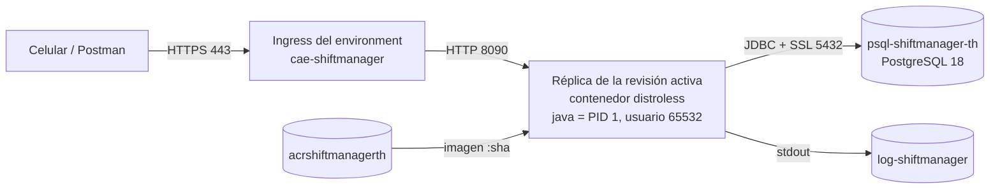

# Defensa: segunda parte

Lo que quedó pendiente en la primera defensa, con qué mostrar y qué decir. Complementa [defensa-paso-a-paso.md](defensa-paso-a-paso.md) (los comandos de siempre) y [guia-parcial.md](guia-parcial.md) (las 50 preguntas).

| Pendiente | Sección |
|---|---|
| Cómo se llama cada cosa de Azure y qué hace | [1](#1-los-recursos-de-azure-nombres-y-qué-hace-cada-uno) |
| Dónde corre la app, en Azure y en local | [2](#2-dónde-corre-la-app) |
| Monitoreo | [3](#3-monitoreo-qué-mostrar) |
| Qué pasa si detengo la app mientras corre un proceso | [4](#4-qué-pasa-si-detengo-la-app-mientras-corre-un-proceso) |
| Los 12 factores | [5](#5-los-12-factores) |
| Hasta qué paso del pipeline llega cada cambio (normal y de Java) | [6](#6-hasta-qué-paso-del-pipeline-llega-cada-cambio) |
| Cómo llega un commit a Azure y qué commit está corriendo | [6](#cómo-llega-un-commit-a-azure-qué-commit-está-corriendo) |
| Lista para el día | [7](#7-lista-para-el-día) |

---

## 1. Los recursos de Azure: nombres y qué hace cada uno

Portal → **Resource groups** → `rg-shiftmanager`. Todo está en **Chile Central**: la política de la facultad solo permite algunas regiones.

| Nombre | Tipo (como aparece en el Portal) | Qué hace | Equivalente en local |
|---|---|---|---|
| `rg-shiftmanager` | **Resource group** | Carpeta lógica que agrupa todos los recursos del proyecto. Los permisos, los costos y el borrado se manejan juntos | La carpeta del proyecto |
| `acrshiftmanagerth` | **Container registry** (Azure Container Registry, plan Basic) | Guarda las imágenes Docker que construye el pipeline, una por commit (`shiftmanager-backend:<sha>`). Sin usuario admin: GitHub sube con el Service Principal (rol AcrPush) y la app descarga con su identidad (rol AcrPull) | Docker Hub, pero privado |
| `cae-shiftmanager` | **Container Apps Environment** | El "cluster" donde viven las Container Apps. Aporta la red, el dominio `*.lemonground-a6322200.chilecentral.azurecontainerapps.io`, la IP pública y la conexión con Log Analytics. Plan Consumption: se paga por uso | La red de Docker Compose |
| `ca-shiftmanager-backend` | **Container App** | La aplicación: qué imagen corre, CPU y memoria (0,5 vCPU y 1 GiB), el puerto 8090, la URL HTTPS pública, las réplicas (0 a 1), las probes, los secretos y las variables de entorno | El servicio `backend` del compose |
| `psql-shiftmanager-th` | **Azure Database for PostgreSQL flexible server** (PostgreSQL 18, Burstable B1ms) | La base de datos administrada: Azure se encarga de los backups, los parches y el certificado SSL. La app se conecta por JDBC con SSL | El servicio `db` del compose |
| `log-shiftmanager` | **Log Analytics workspace** | Recibe los logs de la app (`ContainerAppConsoleLogs_CL`) y los eventos de la plataforma (`ContainerAppSystemLogs_CL`). Se consultan con KQL | `docker compose logs`, pero guardado y con consultas |

**Partes de la Container App** (están dentro de `ca-shiftmanager-backend`, no son recursos separados):

| Parte | Menú del Portal | Qué es |
|---|---|---|
| **Revisión** | *Revisions and replicas* | Una versión inmutable de la app: imagen + configuración. Cada deploy crea una (`ca-shiftmanager-backend--0000012`). Modo de revisión única: la nueva reemplaza a la anterior |
| **Réplica** | *Revisions and replicas* | Una instancia en ejecución de la revisión (un contenedor). Hay 0 cuando nadie la usa y 1 cuando recibe pedidos |
| **Ingress** | *Ingress* | El proxy de entrada: recibe HTTPS en el 443 con el certificado de Azure y reenvía al puerto 8090 del contenedor |
| **Escalado** | *Scale* | Réplicas mínimas 0 y máximas 1. Se apaga sola después de 300 s sin tráfico |
| **Secretos** | *Secrets* | `db-password`, `jwt-secret` y `admin-password`. Las variables los usan con `secretref:` y el valor nunca aparece en la configuración |
| **Identidad** | *Identity* | Identidad administrada (*system assigned*): la app se autentica contra el ACR sin contraseñas |
| **Probes** | *Containers* → *Health probes* | Startup, liveness y readiness contra `/actuator/health/*` |
| **Logs y métricas** | *Log stream*, *Logs*, *Metrics*, *Alerts* | Monitoreo (sección 3) |
| **Consola** | *Console* | No funciona, y es a propósito: la imagen distroless no tiene shell |

**Fuera del resource group:**

| Nombre | Dónde se ve | Qué es |
|---|---|---|
| `sp-shiftmanager-github` | **Microsoft Entra ID** → *App registrations* | Service Principal: la identidad con la que GitHub Actions entra a Azure. Tiene solo tres permisos: AcrPush (ACR), Reader (resource group) y Contributor (únicamente la Container App) |
| Azure for Students | **Subscriptions** | La suscripción que paga todo con el crédito de estudiante |

**Decí**: *"Son cinco recursos dentro de un resource group. El registry guarda las imágenes, el environment es el entorno donde corren las Container Apps, la Container App es mi backend, el flexible server es PostgreSQL y Log Analytics junta los logs. Afuera está el Service Principal, que es la identidad del pipeline."*

---

## 2. Dónde corre la app

### En Azure



- **Físicamente**: en servidores de Microsoft en la región Chile Central (Santiago). Container Apps funciona sobre Kubernetes administrado por Microsoft, pero no veo ni administro los nodos ni las máquinas virtuales: es un servicio de contenedores *serverless*.
- **La réplica** es un contenedor con 0,5 vCPU y 1 GiB de memoria. La JVM usa hasta el 75 % de esa memoria (`MaxRAMPercentage=75`).
- **Adentro del contenedor**: Java 21 sobre distroless, perfil `prod`, puerto 8090, usuario sin privilegios. El proceso `java` es el PID 1, así que recibe directamente las señales de apagado (sección 4).
- **La base** es otro servicio, en la misma región. La app la encuentra por la variable `DB_URL`.

**Dónde se construye** (no es donde corre): en los runners de **GitHub Actions** (`ubuntu-latest`), máquinas virtuales de GitHub que se crean para cada job y se destruyen al terminar. No se construye ni en Azure ni en mi PC.

**Decí**: *"Corre como un contenedor en Azure Container Apps, en Chile Central, sobre un Kubernetes que administra Microsoft. Yo no manejo servidores: le digo qué imagen correr, con cuánta CPU y memoria, y Azure la ejecuta, le pone HTTPS y la escala de 0 a 1 según el tráfico. Se conecta a un PostgreSQL administrado de Azure en la misma región."*

### En local

| Forma | Comando | Dónde corre | Base de datos | Para qué |
|---|---|---|---|---|
| **Gradle** | `cd shiftmanager; .\gradlew bootRun` | JVM directamente en Windows | H2 en memoria (se borra al cerrar) | Desarrollar rápido sin instalar nada |
| **Gradle + PostgreSQL** | `$env:SPRING_PROFILES_ACTIVE="postgres"; .\gradlew bootRun` | JVM en Windows | PostgreSQL instalado en la PC | Probar contra una base real |
| **Docker Compose** | `docker compose up -d --build` | Contenedores Linux dentro de la máquina virtual de Docker Desktop (WSL 2) | Contenedor `postgres:18` con volumen | Lo mismo que en Azure: misma imagen, perfil `prod` y versión de PostgreSQL |
| **Tests** | `.\gradlew build` | JVM (en la PC o en el runner de Actions) | H2 en memoria | Los 36 tests del pipeline |

En esta PC el puerto 8090 está ocupado por otro programa: en el `.env` poner `PORT=8095` y usar `http://localhost:8095`.

La **app mobile** corre en el celular con Expo Go. Apunta a la URL HTTPS de Azure, o a `http://<IP de la PC>:8090` si el backend está en local.

**Decí**: *"En local la levanto con Docker Compose: es la misma imagen que corre en Azure, y Compose levanta también un PostgreSQL 18 en otro contenedor. Corre dentro de la máquina virtual Linux de Docker Desktop. Para desarrollar sin Docker también puedo correrla con Gradle y una base H2 en memoria."*

---

## 3. Monitoreo: qué mostrar

La diferencia: con **observabilidad** puedo ver qué pasa (logs, métricas, health); con **monitoreo**, el sistema se vigila solo y reacciona o avisa. En este proyecto:

| Qué | Reacciona solo | Dónde |
|---|---|---|
| **Probes** (startup, liveness, readiness) | **Sí**: si falla liveness, Azure reinicia el contenedor; si falla readiness (por ejemplo, se cae la base), deja de mandarle tráfico hasta que se recupera | Portal → *Containers* → *Health probes* |
| **Escalado** 0 ↔ 1 | **Sí**: enciende una réplica con el primer pedido y la apaga después de 300 s sin tráfico | *Scale*, métrica *Replica Count* |
| **Logs** de la app y access log | No: se consultan | *Log stream*, *Logs* (KQL) |
| **Métricas** de Azure Monitor y de Actuator | No: se consultan | *Metrics*, `/actuator/metrics` |
| **Alertas** por mail | Sí, pero **no están creadas**, para no gastar crédito. Están documentadas y se crean con tres comandos | [monitoreo.md → Alertas](monitoreo.md#alertas-documentadas-no-creadas) |

### Guion (5 minutos)

1. **¿Está viva?**

   ```powershell
   python scripts/azure_manager.py status
   curl.exe https://ca-shiftmanager-backend.lemonground-a6322200.chilecentral.azurecontainerapps.io/actuator/health/readiness
   ```

2. **Generá tráfico**: Postman → **Run** en la colección (o *Login incorrecto* varias veces).

3. **Logs en vivo**: `python scripts/azure_manager.py logs -f`, o Portal → *Log stream*. Señalá las líneas `ACCESS` (método, ruta, código y milisegundos) y `Login failed` / `Login succeeded`.

4. **Métricas**: Portal → app → *Metrics*:
   - *Requests* → **Apply splitting** → *Status Code Category*: se ven los 2xx y los 4xx de recién;
   - *Average Response Time*, *Replica Count*, *CPU Usage*, *Memory Working Set Bytes*, *Total Replica Restart Count* (0).

5. **Consultas**: Portal → `log-shiftmanager` → *Logs* → consultas 1 (peticiones por endpoint) y 2 (logins) de [monitoreo.md](monitoreo.md#consultas-kql).

6. **Resumen por terminal**: `python scripts/azure_manager.py metrics --hours 24`.

7. **"¿Y si se cae a las 3 de la mañana?"** → hoy: Azure la reinicia sola por la liveness probe y la saca de servicio por la readiness. Para enterarme yo hacen falta alertas: un *action group* que manda mail y reglas sobre *RestartCount*, 5xx y muchos 401 seguidos (posible fuerza bruta). Mostrá Portal → app → *Alerts* → **Create** → **Alert rule** (sin guardar) y los comandos de [monitoreo.md](monitoreo.md#alertas-documentadas-no-creadas).

**Decí**: *"Monitoreo en tres capas. Las probes hacen que Azure reaccione solo: reinicia si la app se cuelga y le saca el tráfico si pierde la base. Los logs van a Log Analytics y los consulto con KQL: cada petición deja una línea con el código y el tiempo. Las métricas de Azure Monitor muestran pedidos por código, tiempos de respuesta, réplicas, CPU, memoria y reinicios. Lo que falta para producción real son las alertas por mail: las dejé documentadas y no las creé para no gastar el crédito."*

---

## 4. ¿Qué pasa si detengo la app mientras corre un proceso?

**Respuesta corta**: *"Se apaga de forma ordenada. Azure le manda SIGTERM al proceso Java. Spring deja de aceptar pedidos nuevos y espera hasta 20 segundos a que terminen los que están en curso; después cierra las conexiones a la base y sale. Si algo dura más, se corta, y como cada operación es una transacción, PostgreSQL la deshace: no queda nada a medias."*

### Cómo funciona

| Momento | Quién | Qué pasa |
|---|---|---|
| 0 s | Azure (stop, deploy nuevo o escalado a 0) | Manda **SIGTERM** al PID 1 del contenedor, que es `java` |
| 0 s | Spring Boot | `Commencing graceful shutdown`: Tomcat deja de aceptar conexiones nuevas |
| 0 a 20 s | Spring Boot | Espera a los pedidos en curso (`server.shutdown=graceful`, `spring.lifecycle.timeout-per-shutdown-phase=20s`) |
| al terminar | Spring Boot | `Graceful shutdown complete` → cierra JPA → `ShiftmanagerPool - Shutdown completed` (devuelve las conexiones a PostgreSQL) → sale con código 143 |
| 30 s | Azure | Si el proceso sigue vivo, manda **SIGKILL**. Como Spring corta a los 20 s, siempre termina antes |

La configuración está en `shiftmanager/src/main/resources/application.properties` (`server.shutdown` y `spring.lifecycle.timeout-per-shutdown-phase`). Los 30 s son el *termination grace period* por defecto de Container Apps. En `docker-compose.yml` se igualó con `stop_grace_period: 30s`.

### Los casos

| Caso | Qué pasa |
|---|---|
| Pedido en curso que termina en menos de 20 s | **Termina normalmente** y el cliente recibe la respuesta |
| Pedido en curso que dura más de 20 s | Se corta (`Graceful shutdown aborted`) y el cliente recibe un error. La transacción no llegó al commit: **PostgreSQL la deshace** |
| Pedido nuevo durante el apagado | Rechazado: Tomcat ya no acepta conexiones |
| Muerte abrupta (SIGKILL, falla del servidor, falta de memoria) | No hay apagado ordenado, pero vale lo mismo: lo que no se confirmó se descarta (`@Transactional` + ACID de PostgreSQL). Al volver a arrancar, Flyway valida el esquema y HikariCP abre conexiones nuevas |
| Check-in cortado antes del commit | No queda registrado: el guardia lo repite y funciona |
| Check-in confirmado pero la respuesta no llegó | Al repetirlo da 400 *"already has a check-in"*: el dato quedó bien guardado una sola vez |
| **Deploy de una versión nueva** | Azure levanta la revisión nueva, espera a que pase las probes, le pasa el tráfico y **recién ahí** manda SIGTERM a la vieja: no hay corte |
| **Stop** | Sí hay corte para los pedidos nuevos, porque no queda ninguna réplica (máximo 1) |
| Escalado a 0 | El mismo SIGTERM, pero solo ocurre después de 300 s sin pedidos |

**¿Por qué llega la señal?** El `ENTRYPOINT` del Dockerfile está en forma *exec* (`["java", ...]`): Java es el PID 1 y recibe SIGTERM directamente. Si se lanzara con `sh -c`, el shell podría no reenviarla (y distroless ni siquiera tiene shell).

### Demo en vivo

Endpoint de demostración, solo para ADMIN: `GET /api/admin/demo/slow-process?seconds=15` simula un proceso de N segundos (de 1 a 30).

**En Azure** (usá **30 s**: Azure tarda unos 12 a 14 s en hacer llegar el SIGTERM después del `stop`, así que con 15 s el proceso termina antes de que Spring empiece a esperar):

```powershell
python scripts/azure_manager.py start            # si estaba detenida; esperar el UP
```

1. Postman → *2. Autenticación JWT* → *Login correcto* (para tener el token).
2. Postman → carpeta *6. Apagado ordenado (ADMIN)* → *Proceso lento de 30 s* → **Send** (queda esperando).
3. Enseguida, en la terminal: `python scripts/azure_manager.py stop`.
4. A los 30 s Postman muestra **200**. Mostrá los logs con la consulta 7 de [monitoreo.md](monitoreo.md#consultas-kql) (tardan 1 o 2 minutos en llegar a Log Analytics).
5. `python scripts/azure_manager.py start` para seguir.

**Decí**: *"Lancé un proceso de 30 segundos y apagué la app a los 3. Azure le mandó SIGTERM, Spring dejó de aceptar pedidos nuevos, esperó a que el proceso terminara, recién ahí cerró el pool de conexiones y salió. El usuario recibió su respuesta."*

**En local** (Docker Desktop abierto, `.env` con `PORT=8095`). Acá el SIGTERM llega enseguida, así que alcanza con 15 s, y también se puede mostrar el corte:

```powershell
docker compose up -d --build
# Postman, environment Local → carpeta 6 → "Proceso lento de 15 s" → Send, y mientras espera:
docker compose stop backend
docker compose logs backend | Select-String "Slow process|graceful|Shutdown completed|still running"
docker compose start backend
```

Para mostrar el corte, cambiá `seconds=15` por `seconds=25`: Spring espera 20 s y lo corta.

### Resultados reales

**Local** (Docker, 2026-10-26; detenido a los 3 s del pedido):

| Proceso | Respuesta | Logs |
|---|---|---|
| 15 s | **200** en 15,1 s | `Slow process started` → `Commencing graceful shutdown` → `Slow process finished` → `Graceful shutdown complete` → `ShiftmanagerPool - Shutdown completed` → exit 143 |
| 25 s | Error (conexión cerrada) a los 23,6 s | `Commencing graceful shutdown` → a los 20 s `ends with 1 bean still running after timeout of 20000ms` → `Slow process interrupted` → `Graceful shutdown aborted with one or more requests still active` → `Shutdown completed` → exit 143 |
| Pedido nuevo durante el apagado | Rechazado | — |

Antes de corregir el compose, Docker mataba el contenedor a los 4 s (exit 137) y el proceso de 15 s se cortaba. Por eso ahora tiene `stop_grace_period: 30s`.

**Azure** (2026-10-26, imagen `32cff90`, `stop` a los 3 s del pedido; hora de los logs de la app en Log Analytics):

| Proceso | Respuesta | Logs |
|---|---|---|
| 30 s | **200** en 30,2 s | 22:50:25.9 `Slow process started (30 s)` → (22:50:28 `stop`) → 22:50:40.9 `Commencing graceful shutdown` → 22:50:55.9 `Slow process finished` → 22:50:55.9 `Graceful shutdown complete` → `ShiftmanagerPool - Shutdown completed` |
| 15 s | **200** en 15,8 s | El SIGTERM llegó a las 22:43:50, 14 s después del `stop` y 2 s después de que terminara el proceso |
| Pedido nuevo después del `stop` | **404** | La app detenida ya no tiene réplicas: el ingress de Azure responde 404 |

En Azure el proceso de 30 s es el que muestra a Spring **esperando** (15 s entre `Commencing` y `finished`). El corte de un proceso largo solo se puede mostrar en local: en Azure haría falta más de 30 s (el máximo del endpoint).

También en la primera defensa (2026-10-20 a las 18:05), al hacer *stop* quedó en Log Analytics: `Commencing graceful shutdown` → `Graceful shutdown complete` → `Closing JPA EntityManagerFactory` → `ShiftmanagerPool - Shutdown completed`.

**Es el factor IX** (desechabilidad): arranca rápido, se apaga de forma ordenada con SIGTERM y tolera una muerte abrupta sin perder datos.

---

## 5. Los 12 factores

Una metodología para que las aplicaciones se puedan desplegar en la nube: configuración separada del código, procesos sin estado, logs como flujo de eventos y la misma app en todos los entornos.

| # | Factor | Qué pide | Cómo lo cumple este proyecto | Dónde mostrarlo |
|---|---|---|---|---|
| I | **Codebase** | Un repositorio, muchos despliegues | Un repo en Git. Del mismo código salen el local, las imágenes de `dev` y `main` y el deploy en Azure | GitHub |
| II | **Dependencies** | Declarar y aislar las dependencias | Todas en `build.gradle`, con el Gradle Wrapper fijado. La imagen trae todo lo que necesita: no depende de nada instalado en el servidor | `build.gradle`, Dockerfile |
| III | **Config** | La configuración en el entorno | Lo que cambia entre entornos sale de variables de entorno (`DB_URL`, `JWT_SECRET`...). El perfil `prod` no tiene valores por defecto: si falta un secreto, no arranca | `application-prod.properties`, *Containers* → variables |
| IV | **Backing services** | Los servicios externos como recursos conectables | PostgreSQL se conecta por URL: pasar del contenedor local al de Azure cambia solo `DB_URL`, no el código | `.env.example`, secrets de la Container App |
| V | **Build, release, run** | Separar construir, publicar y ejecutar | *Build*: el pipeline genera la imagen `:<sha>`. *Release*: imagen + configuración = revisión. *Run*: Azure la ejecuta. Volver atrás es desplegar otra imagen sin recompilar | Actions, ACR, *Revisions* |
| VI | **Processes** | Procesos sin estado | Sin sesión (JWT, `STATELESS`) y sin archivos locales: todo el estado está en PostgreSQL. Cualquier réplica puede atender cualquier pedido | `SecurityConfig` |
| VII | **Port binding** | La app se expone sola en un puerto | Tomcat embebido en el puerto `PORT` (8090). Azure solo enruta tráfico a ese puerto | `--target-port 8090`, *Ingress* |
| VIII | **Concurrency** | Escalar agregando procesos | Escala horizontal con réplicas. Hoy el máximo es 1 por costo, pero al no tener estado se puede subir sin tocar el código; el pool de HikariCP (5 conexiones) deja lugar para más réplicas | *Scale* |
| IX | **Disposability** | Arranque rápido y apagado ordenado | Arranca en unos 30 s y se apaga de forma ordenada con SIGTERM (sección 4). Sin estado local, perder una réplica no pierde datos | Sección 4, consulta 7 |
| X | **Dev/prod parity** | Desarrollo y producción lo más parecidos posible | Docker Compose usa la misma imagen, el mismo perfil `prod` y PostgreSQL 18, como Azure. Diferencia consciente: los tests y `bootRun` sin perfil usan H2 en memoria, por velocidad | `docker-compose.yml` |
| XI | **Logs** | Los logs como flujo de eventos | Todo a stdout, incluido el access log. La app no maneja archivos; Azure los recolecta en Log Analytics | *Log stream*, KQL |
| XII | **Admin processes** | Las tareas de administración, con el mismo código y la misma configuración | Las migraciones de Flyway y la creación del primer admin corren con la misma imagen y la misma configuración, al arrancar. Las operaciones de Azure están en `scripts/azure_manager.py` | Flyway, `DataSeeder` |

Los que más se relacionan con lo que preguntó el profesor: **IX** (apagar con un proceso en curso), **XI** (logs y monitoreo), **III** (secretos y configuración) y **V** (versiones y rollback).

---

## 6. ¿Hasta qué paso del pipeline llega cada cambio?

El workflow `CI/CD` tiene 3 jobs en cadena: **Build y tests** (alrededor de 1 min) → **Imagen, Grype y push al ACR** (alrededor de 3 min) → **Deploy a Azure Container Apps** (alrededor de 2 min). Si un job falla, los siguientes no corren. En paralelo, cada push también dispara **CodeQL**.

### Lo que pasó en la primera defensa (2026-10-20)

| Cambio | Rama | Build y tests | Imagen, Grype, push | Deploy |
|---|---|---|---|---|
| Una línea en el README (`415049a`) | push directo a `dev` | ✓ | ✓ (imagen `:415049a` en el ACR) | ⊘ *skipped* |
| Un comentario en `DataSeeder.java` (`007a563`) | push directo a `dev` | ✓ 44 s | ✓ 3 min (imagen `:007a563`) | ⊘ *skipped* |

Los dos llegaron hasta el ACR y no se desplegaron. **Es lo esperado**: en `dev` y `main` el pipeline construye y publica la imagen, pero solo despliega lo que llega a la rama `deploy`. Que el cambio fuera en el README o en Java no cambia nada: el pipeline no filtra por carpeta, así que cada commit queda como una versión con su imagen.

**Decí**: *"Llegó hasta el push al registry. El deploy aparece en gris porque fue a dev: en mi flujo solo se despliega lo que llega a la rama deploy. Si lo quiero en Azure, lo paso a main y de main a deploy, y ahí corre el tercer job."*

### Cada tipo de cambio

| Cambio | Hasta dónde llega | Qué queda en Azure |
|---|---|---|
| README o comentario, a `dev` o `main` | Push al ACR. Deploy *skipped* | La versión anterior |
| Cualquier cambio que llega a `deploy` | Los 3 jobs. Al final verifica que `/actuator/info` responda con el SHA nuevo | La versión nueva |
| Pull request | Tests + imagen + Grype. **Nada se publica** (sin login a Azure) | La versión anterior |
| Java que **no compila** | Corta en **Build y tests** (paso *Compilar y ejecutar los tests*) | La versión anterior |
| Java que **rompe un test** | Corta en **Build y tests**. El artifact *reporte-tests* dice cuál falló | La versión anterior |
| Dependencia con una vulnerabilidad alta o crítica que tiene parche | Corta en **Imagen, Grype y push** (paso *Grype - control de seguridad*). No se sube | La versión anterior |
| Falta un secreto o la app no arranca | Corta en **Deploy** (paso *Verificar que la versión nueva responde*, después de 6 min) | **La revisión anterior sigue atendiendo** |

El aviso amarillo *"Failed minimum severity level. Found vulnerabilities with level 'medium' or higher"* sale del paso del **informe completo** de Grype, que nunca corta el build. El que corta es el paso siguiente (*control de seguridad*), y ese pasó.

### Demos

**Cambio normal hasta Azure** (un archivo cualquiera, por ejemplo el saludo de `GreetingController.java`):

```powershell
git checkout dev; git pull
git checkout -b feature/cambio-parcial
# editar y guardar
git commit -am "feat: cambia el saludo"
git push -u origin feature/cambio-parcial
gh pr create --base dev --fill; gh pr merge --merge          # 1) llega al ACR (deploy skipped)
gh pr create --base main --head dev --fill; gh pr merge --merge
git fetch origin; git push origin origin/main:deploy        # 2) los 3 jobs: llega a Azure
gh run watch
python scripts/azure_manager.py version                     # los tres SHA iguales
```

**Cambio de Java que rompe un test** (para mostrar dónde corta):

1. En `shiftmanager/src/main/java/com/security/shiftmanager/model/HoursCalculator.java` cambiá `BigDecimal.valueOf(60)` por `BigDecimal.valueOf(61)`.
2. Subilo a una rama y abrí el PR a `dev` (los mismos comandos que arriba, sin el merge).
3. Actions: **Build y tests** en rojo (fallan 3 tests de `HoursCalculatorTest`), Imagen y Deploy no corren. `gh run view --log-failed` muestra el error.
4. Decí: *"Falló un test, así que no se construyó la imagen y en Azure sigue la versión que andaba."*
5. Cerralo sin mergear: `gh pr close --delete-branch`.

**Java que no compila**: borrá un `;` en cualquier clase. Mismo resultado, pero en la compilación.

### ¿Cómo llega un commit a Azure? ¿Qué commit está corriendo?

**Qué dispara el deploy**: que un commit llegue a la rama `deploy`. Para desplegar no hago un commit nuevo: con `git push origin origin/main:deploy` muevo la rama `deploy` al mismo commit que `main`. Ese push dispara el workflow, y como la rama es `deploy`, corre también el tercer job.

**El SHA del commit es la versión** y la sigo de punta a punta. Ejemplo real, lo que está hoy en Azure:

| Paso | Dónde | Valor |
|---|---|---|
| 1. Commit | GitHub, rama `deploy` (el merge del PR #40) | `32cff908b7d5e7292c97cd83ae2a0a3f85ff896b` |
| 2. Run del pipeline | Actions → run *Merge pull request #40* en `deploy` | Usa `GITHUB_SHA` y lo corta a 7 caracteres: `32cff90` |
| 3. Imagen | ACR → `shiftmanager-backend` → tag | `acrshiftmanagerth.azurecr.io/shiftmanager-backend:32cff90` (digest `sha256:870318ce…`) |
| 4. Adentro de la imagen | Etiquetas OCI y variables `APP_VERSION` / `GIT_COMMIT` | `org.opencontainers.image.revision` = SHA completo |
| 5. Revisión | Portal → *Revisions and replicas* | `ca-shiftmanager-backend--0000013` con la imagen `:32cff90` |
| 6. La app en ejecución | `/actuator/info` | `"version":"32cff90"`, `"commit":"32cff908b7d5…"` |

Al final, el job de Deploy consulta `/actuator/info` hasta que responde con ese SHA: así confirma que en Azure corre exactamente ese commit, y no solo que el comando se ejecutó.

**Comprobarlo en vivo:**

```powershell
python scripts/azure_manager.py version        # OK: 32cff90 / 32cff90 / 32cff90  (rama deploy / imagen de la app / /actuator/info)
git log -1 --oneline origin/deploy             # el commit en GitHub
python scripts/azure_manager.py tags           # todas las imágenes del ACR, una por commit
```

En el navegador: GitHub → rama `deploy` → SHA del último commit; Portal → app → *Containers* → la imagen termina en `:<sha>`; `<URL>/actuator/info`.

**De un commit cualquiera a Azure:**
- Si ya pasó por `dev` o `main`, su imagen ya existe en el ACR: Actions → **Run workflow** → *Desplegar* + `image_tag` = el SHA corto. Despliega sin recompilar (también sirve para volver atrás).
- Si es nuevo: PR a `dev` → PR `dev` → `main` → `git push origin origin/main:deploy`.

**Decí**: *"Cada commit tiene un SHA. El pipeline lo usa como tag de la imagen y lo mete adentro de la imagen, y la app lo devuelve en /actuator/info. Para desplegar, muevo la rama deploy al commit de main: ese push dispara el pipeline completo. Para saber qué commit corre en Azure, comparo el último commit de deploy, la imagen de la Container App y lo que responde la app: si los tres coinciden, en Azure está exactamente ese commit."*

---

## 7. Lista para el día

**La noche anterior o temprano:**

```powershell
gh auth switch --user HerreroT       # en esta PC la cuenta activa de gh es otra (herrerotomas) y no puede crear PRs
gh auth status                       # Active account: HerreroT
git checkout dev; git pull
az account show --query name         # "Azure for Students"
az postgres flexible-server show -g rg-shiftmanager -n psql-shiftmanager-th --query state   # "Ready"
python scripts/azure_manager.py scale 1
python scripts/azure_manager.py version
```

**Abierto antes de entrar:** Actions del repo; Portal en `rg-shiftmanager` (para nombrar los recursos) y en `ca-shiftmanager-backend`; Log Analytics con las consultas 1, 2 y 7 pegadas; Postman con el environment *Azure* y el token cargado (*Login correcto*).

**Orden sugerido si te deja elegir:**
1. Recursos de Azure (sección 1) → dónde corre (sección 2).
2. Monitoreo (sección 3).
3. Apagado con un proceso en curso, en vivo (sección 4).
4. Cambio normal hasta Azure y cambio de Java que rompe un test (sección 6).
5. Los 12 factores, si pregunta (sección 5).

**Al terminar:**

```powershell
python scripts/azure_manager.py scale 0
az postgres flexible-server stop -g rg-shiftmanager -n psql-shiftmanager-th   # la base cobra por hora mientras está prendida
```
