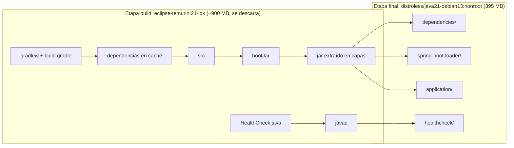

# Docker

## Dockerfile multietapa

Archivo: `shiftmanager/Dockerfile`.



| Decisión | Por qué |
|---|---|
| Dos etapas | El JDK y Gradle solo sirven para compilar; la imagen final lleva solo la JRE y la aplicación |
| Dependencias antes que el código | Si solo cambia el código, Docker reutiliza la capa de dependencias (build más rápido) |
| `-x test` en el build | Los tests corren en GitHub Actions antes de construir la imagen; no se repiten |
| Jar extraído en capas | Las dependencias (que casi no cambian) quedan en una capa distinta al código: los push al ACR suben solo lo que cambió |
| `distroless/java21-debian13:nonroot` | Sin shell ni gestor de paquetes (menos superficie de ataque y menos CVE), usuario sin privilegios (uid 65532). Elegida comparando bases con Grype (ver `docs/seguridad.md`) |
| `USER 65532:65532` | El proceso no corre como root |
| `TZ=America/Argentina/Buenos_Aires` | El check-in/check-out guarda la hora local; sin esto el contenedor usa UTC y quedaría 3 horas adelantado |
| `JAVA_TOOL_OPTIONS=-XX:MaxRAMPercentage=75` | El heap se calcula según la memoria que Azure le asigna al contenedor |
| `HEALTHCHECK` con `HealthCheck.java` | Distroless no tiene `curl`; una clase Java mínima consulta `/actuator/health` |
| Etiquetas OCI al final | Trazabilidad (versión, fecha, commit, repositorio) sin invalidar la caché de las capas anteriores |
| `--platform linux/amd64` | Azure Container Apps ejecuta amd64; así la imagen sirve aunque se construya en una Mac con Apple Silicon |

El `.dockerignore` (`shiftmanager/.dockerignore`) evita mandar al build `build/`, `.gradle/`, `.git` y cualquier `.env`.

### Construir y ejecutar la imagen sola

PowerShell, desde la raíz del repositorio:

```powershell
$sha = git rev-parse --short=7 HEAD
docker build --platform linux/amd64 `
  --build-arg VERSION=$sha `
  --build-arg BUILD_DATE=(Get-Date).ToUniversalTime().ToString("yyyy-MM-ddTHH:mm:ssZ") `
  --build-arg VCS_REF=(git rev-parse HEAD) `
  -t shiftmanager-backend:$sha ./shiftmanager

# Ver las etiquetas OCI
docker image inspect shiftmanager-backend:$sha --format '{{json .Config.Labels}}'
```

Para ejecutarla hace falta una base PostgreSQL y las variables del perfil `prod`; lo más simple es Docker Compose.

## Docker Compose

Archivo: `docker-compose.yml` (raíz). Levanta PostgreSQL 18 y el backend.

| Elemento | Configuración |
|---|---|
| `db` | `postgres:18`, volumen `pgdata` (persistente), health check con `pg_isready`, **sin puerto publicado** (solo el backend la ve) |
| `backend` | Se construye desde `./shiftmanager`, perfil `prod`, espera a que `db` esté healthy (`depends_on: condition: service_healthy`), health check del Dockerfile |
| Red `backend` | Red interna entre los dos servicios; el backend llega a la base como `db:5432` |
| Variables | Se leen de `.env` (no versionado). Si falta `DB_PASSWORD`, `JWT_SECRET` o `ADMIN_PASSWORD`, compose no arranca |

### Dockerfile vs. Docker Compose

- **Dockerfile**: receta para construir **una imagen** (qué se instala, qué se copia, cómo arranca).
- **Docker Compose**: describe **cómo se ejecutan varios contenedores juntos** (qué imágenes, variables, puertos, redes, volúmenes y en qué orden).

### Comandos (PowerShell, desde la raíz del repositorio)

```powershell
# 1. Primera vez: crear el .env y cambiar los secretos
Copy-Item .env.example .env
notepad .env
```

Para generar un valor aleatorio para `DB_PASSWORD`, `JWT_SECRET` o `ADMIN_PASSWORD`:

```powershell
[Convert]::ToBase64String((1..48 | ForEach-Object { Get-Random -Maximum 256 }))
```

| Acción | Comando |
|---|---|
| Iniciar (construye la imagen si hace falta) | `docker compose up -d --build` |
| Ver el estado y el health check | `docker compose ps` |
| Ver los logs (en vivo) | `docker compose logs -f backend` |
| Ver los logs de la base | `docker compose logs db` |
| Reiniciar el backend | `docker compose restart backend` |
| Reconstruir después de cambiar código | `docker compose up -d --build backend` |
| Detener sin borrar nada | `docker compose stop` |
| Eliminar los contenedores **conservando los datos** | `docker compose down` |
| Eliminar contenedores **y datos** (irreversible) | `docker compose down -v` |

Comprobar que funciona:

```powershell
curl.exe http://localhost:8090/actuator/health      # {"status":"UP",...}
curl.exe http://localhost:8090/actuator/info        # versión y commit
```

Y ejecutar la colección de Postman (`docs/postman`) con el environment `local`.

> Si el puerto 8090 está ocupado, cambiá `PORT` en `.env` (por ejemplo `PORT=8097`) y usá ese puerto en las URLs.

### Pruebas realizadas

| Prueba | Resultado |
|---|---|
| `docker compose config` sin `.env` | Falla con "required variable DB_PASSWORD / JWT_SECRET / ADMIN_PASSWORD is missing" |
| `docker compose up -d --build` | `db` y `backend` healthy; datos demo cargados (8 guardias) |
| Crear un guardia, `docker compose down`, `docker compose up -d` | El guardia sigue existiendo (volumen `shiftmanager_pgdata`) |
| Contenedor con 0.5 CPU y 512 MB | Arranca en 36 s y usa ~300 MB |
| `docker exec <contenedor> sh` | Falla: la imagen no tiene shell |
| Variables y capas de la imagen | Sin contraseñas ni secretos |
