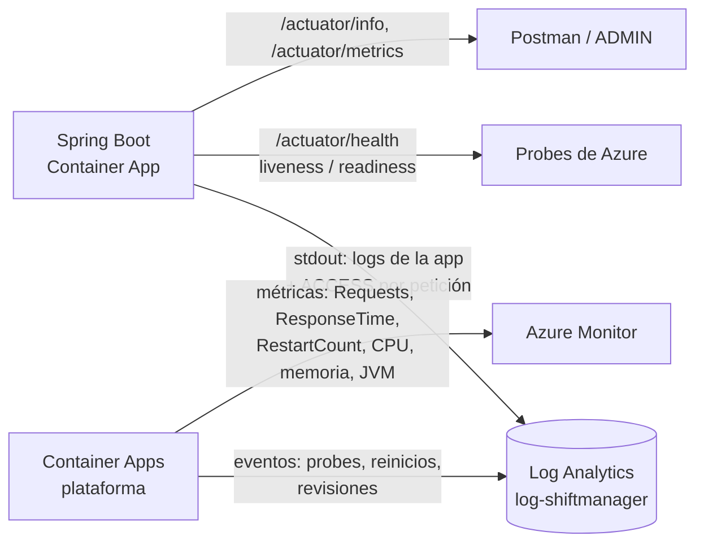

# Monitoreo y observabilidad

Cómo se comprueba, con información observable, que el backend funciona en Azure: salud, logs, métricas y consultas.



## Componentes

| Componente | Qué aporta | Dónde se ve |
|---|---|---|
| **Spring Boot Actuator** | `/actuator/health` (+ `liveness`, `readiness` con la base), `/actuator/info` (versión y commit), `/actuator/metrics` (Micrometer) | URL pública; detalle y métricas solo con token ADMIN |
| **Micrometer** | Métricas internas: `http.server.requests` (cantidad y tiempos por URI y código), `hikaricp.connections.*`, `jvm.*` | `GET /actuator/metrics/<nombre>` |
| **Health checks** | Docker `HEALTHCHECK` (local) y probes HTTP de Container Apps (startup, liveness, readiness) | `docker compose ps`; Portal → app → **Containers** → *Health probes* |
| **Logs de la aplicación** | Arranque, perfil activo, conexión a la base, migraciones, logins correctos/fallidos, errores | Log Analytics, tabla `ContainerAppConsoleLogs_CL` |
| **Access log** (perfil `prod`) | Una línea por petición: `ACCESS <ip> "<método> <ruta>" <código> <bytes> <ms>ms` | Misma tabla, líneas que empiezan con `ACCESS` |
| **Logs de sistema** | Eventos de la plataforma: imagen descargada, contenedor iniciado, probe fallida, revisión lista | Tabla `ContainerAppSystemLogs_CL` |
| **Azure Monitor** | `Requests` (por código), `ResponseTime`, `RestartCount`, `Replicas`, CPU, memoria y métricas de la JVM (heap, GC, threads; activadas con `--enable-java-metrics`) | Portal → app → **Monitoring** → **Metrics** |

No se usa Application Insights: daría trazas por petición y dependencias (SQL), pero requiere agregar el agente Java a la imagen (más tamaño, arranque y superficie de vulnerabilidades). El access log + Azure Monitor + Actuator responden todas las preguntas de abajo sin piezas extra. Si se quisiera agregar: crear un recurso Application Insights conectado a `log-shiftmanager`, copiar su *Connection string* (Portal → Application Insights → *Overview*), guardarla como secret de la Container App (`APPLICATIONINSIGHTS_CONNECTION_STRING=secretref:...`) y sumar el agente `applicationinsights-agent.jar` con `-javaagent` en el Dockerfile.

## Preguntas y cómo responderlas

| Pregunta | Cómo se responde |
|---|---|
| ¿Spring Boot está funcionando? | `GET /actuator/health` → `{"status":"UP"}`. En Azure: `python scripts/azure_manager.py status` (Running) y la métrica `Replicas` |
| ¿Se conecta a la base? | `GET /actuator/health/readiness` (incluye la base) → `UP`; con token ADMIN, `/actuator/health` muestra `components.db` = `PostgreSQL` `UP`. Si la base se cae, readiness pasa a `DOWN` (503) y Azure deja de mandarle tráfico (probado con PostgreSQL detenido: se recupera solo en ~2 s) |
| ¿Llegó una petición al servidor? | Consulta KQL 1 (línea `ACCESS` con método, ruta y código) o métrica `Requests` |
| ¿Funcionó el login? | Consulta KQL 2 (`Login succeeded` / `Login failed: <motivo>`), o `http.server.requests` con `uri=/api/auth/login` separado por `status` 200/401 |
| ¿Cuánto tardó una petición? | Campo `ms` del access log (consulta 1), `ResponseTime` en Azure Monitor, o `http.server.requests` (`TOTAL_TIME`, `MAX`) en Actuator |
| ¿Cómo veo un error? | Consulta KQL 5 (`ERROR`/`Exception`), `python scripts/azure_manager.py logs`, o el access log filtrado por `status >= 500` |
| ¿Cómo reviso los logs desde Azure? | Portal → `ca-shiftmanager-backend` → **Monitoring** → **Log stream** (en vivo) o **Logs** (KQL). Terminal: `az containerapp logs show -g rg-shiftmanager -n ca-shiftmanager-backend --tail 100 --follow` |
| ¿La aplicación se está reiniciando? | Métrica `RestartCount` (0 hasta ahora) y consulta KQL 4 (`ContainerAppSystemLogs_CL`); `revisions` muestra las réplicas |
| ¿Fallaron variables de entorno? | La app no arranca y el log muestra `Could not resolve placeholder 'JWT_SECRET'` (perfil `prod` sin valores por defecto). La revisión queda *Unhealthy*/*Failed* y **la revisión anterior sigue atendiendo**. Consulta KQL 6 |

## Consultas KQL

Portal → **Log Analytics workspaces** → `log-shiftmanager` → **Logs** (o desde la Container App → **Logs**), pegar la consulta → **Run**.

**1. Peticiones por endpoint, código y tiempo**

```kusto
ContainerAppConsoleLogs_CL
| where TimeGenerated > ago(1h) and Log_s startswith "ACCESS"
| parse Log_s with "ACCESS " ip " \"" method " " path " " proto "\" " status:int " " bytes " " ms:long "ms"
| where path !startswith "/actuator/health"          // sin las probes
| extend endpoint = tostring(split(path, "?")[0])
| summarize peticiones = count(), promedio_ms = round(avg(ms), 1), max_ms = max(ms) by method, endpoint, status
| order by peticiones desc
```

**2. Logins correctos y fallidos**

```kusto
ContainerAppConsoleLogs_CL
| where TimeGenerated > ago(24h) and Log_s has "Login "
| extend resultado = iff(Log_s has "Login succeeded", "correcto", "fallido")
| summarize cantidad = count() by resultado, bin(TimeGenerated, 1h)
```

**3. Arranques (cuánto tarda Spring Boot y en qué revisión)**

```kusto
ContainerAppConsoleLogs_CL
| where Log_s has "Started ShiftmanagerApplication"
| parse Log_s with * "Started ShiftmanagerApplication in " segundos " seconds" *
| project TimeGenerated, RevisionName_s, segundos
| order by TimeGenerated desc
```

**4. Eventos de la plataforma (probes, reinicios, revisiones)**

```kusto
ContainerAppSystemLogs_CL
| where TimeGenerated > ago(24h)
| summarize cantidad = count(), ultimo = max(TimeGenerated) by Reason_s
| order by cantidad desc
```

**5. Errores de la aplicación**

```kusto
ContainerAppConsoleLogs_CL
| where TimeGenerated > ago(24h)
| where Log_s has_any (" ERROR ", "Exception")
| where Log_s !has "BadCredentialsException" and Log_s !has "DisabledException"   // logins fallidos
| project TimeGenerated, RevisionName_s, Log_s
```

**6. Configuración faltante al arrancar**

```kusto
ContainerAppConsoleLogs_CL
| where Log_s has_any ("Could not resolve placeholder", "APPLICATION FAILED TO START")
| project TimeGenerated, RevisionName_s, Log_s
```

**7. Apagados ordenados (stop, deploy, escalado a 0)**

```kusto
ContainerAppConsoleLogs_CL
| where TimeGenerated > ago(24h)
| where Log_s has_any ("graceful", "Shutdown completed", "Slow process", "still running")
| project TimeGenerated, RevisionName_s, Log_s
| order by TimeGenerated asc, Log_s asc
```

`has` busca palabras completas (`graceful` sí, `raceful` no). `Commencing graceful shutdown` → (`Slow process finished` si había un proceso en curso) → `Graceful shutdown complete` → `ShiftmanagerPool - Shutdown completed`. Detalle en [defensa-segunda-parte.md](defensa-segunda-parte.md#4-qué-pasa-si-detengo-la-app-mientras-corre-un-proceso).

### Resultados reales (2026-10-20, revisión con la imagen `d16c9a2`)

Consulta 1, después de generar tráfico de prueba:

| Método | Endpoint | Código | Peticiones | Promedio | Máximo |
|---|---|---|---|---|---|
| GET | `/api/guards` | 200 | 5 | 23,4 ms | 76 ms |
| GET | `/api/guards/9999` | 404 | 5 | 12,4 ms | 22 ms |
| GET | `/api/guards` (sin token) | 401 | 5 | 2,6 ms | 6 ms |
| GET | `/api/reports/monthly-hours` | 200 | 5 | 115 ms | 330 ms |
| POST | `/api/auth/login` | 401 | 3 | 286,7 ms | 593 ms |
| POST | `/api/auth/login` | 200 | 1 | 226 ms | 226 ms |

El login tarda más que el resto a propósito: BCrypt es lento por diseño para dificultar ataques de fuerza bruta.

- Consulta 3: arranques de 29-34 s por revisión.
- Consulta 4: 0 reinicios. Los eventos `ReplicaUnhealthy` son la probe de **startup** recibiendo *connection refused* durante los ~30 s de arranque de cada despliegue (y alguna readiness justo después). Es el comportamiento esperado: la réplica nueva no recibe tráfico hasta que pasa las probes.
- Azure Monitor: `ResponseTime` promedio 27-45 ms, `RestartCount` 0, memoria ~20 % de 1 GiB.

## Métricas en Azure Monitor

Portal → `ca-shiftmanager-backend` → **Monitoring** → **Metrics** → *Metric*: **Requests** (botón *Apply splitting* → `Status Code Category` para separar 2xx/4xx/5xx), **Average Response Time**, **Total Replica Restart Count**, **Replica Count**, **Memory Percentage**, **jvm.memory.used**, **jvm.gc.count**.

Terminal:

```powershell
$id = az containerapp show -g rg-shiftmanager -n ca-shiftmanager-backend --query id -o tsv
az monitor metrics list --resource $id --metric Requests --interval PT1H --aggregation Total -o table
az monitor metrics list --resource $id --metric ResponseTime --interval PT1H --aggregation Average -o table
az monitor metrics list --resource $id --metric RestartCount --interval PT1H --aggregation Total -o table
```

## Alertas (documentadas, no creadas)

Las probes hacen que Azure reaccione solo (reinicia o saca de servicio), pero nadie se entera. Para recibir un mail hacen falta un *action group* y reglas de alerta sobre las métricas. No están creadas para no gastar crédito: cada regla de métrica cuesta alrededor de US$ 0,10 por mes y el mail del action group es gratis.

```powershell
az monitor action-group create -g rg-shiftmanager -n ag-shiftmanager --short-name shiftmgr `
  --action email tomas t.herrero@alumno.um.edu.ar
$app = az containerapp show -g rg-shiftmanager -n ca-shiftmanager-backend --query id -o tsv

# La app se reinicia (liveness fallando, falta de memoria)
az monitor metrics alert create -g rg-shiftmanager -n alerta-reinicios --scopes $app `
  --condition "total RestartCount > 0" --window-size 5m --evaluation-frequency 1m `
  --severity 2 --action ag-shiftmanager --description "La app se está reiniciando"

# Errores del servidor
az monitor metrics alert create -g rg-shiftmanager -n alerta-errores-5xx --scopes $app `
  --condition "total Requests > 5 where statusCodeCategory includes 5xx" --window-size 5m --evaluation-frequency 1m `
  --severity 1 --action ag-shiftmanager --description "Más de 5 errores 5xx en 5 minutos"

# Muchos 4xx seguidos: posible fuerza bruta contra el login
az monitor metrics alert create -g rg-shiftmanager -n alerta-fuerza-bruta --scopes $app `
  --condition "total Requests > 30 where statusCodeCategory includes 4xx" --window-size 5m --evaluation-frequency 1m `
  --severity 2 --action ag-shiftmanager --description "Más de 30 respuestas 4xx en 5 minutos"
```

En el Portal: app → **Alerts** → **Create** → **Alert rule** → *Signal*: *Requests* / *Total Replica Restart Count* → condición y umbral → *Actions*: el action group → nombre y severidad. La alerta se dispara en 1 a 5 minutos y llega un mail; se ve en **Monitor** → **Alerts**. Para borrarlas: `az monitor metrics alert delete -g rg-shiftmanager -n <nombre>`.

Una alerta sobre los logs (por ejemplo, `APPLICATION FAILED TO START`) también es posible con *log search alerts*, pero cuesta más porque ejecuta la consulta KQL cada pocos minutos.

## Métricas de la aplicación (Actuator, token ADMIN)

| Endpoint | Para qué |
|---|---|
| `/actuator/metrics/http.server.requests?tag=uri:/api/auth/login` | Cantidad de logins, tiempo total y máximo; separado por `status` (200 / 401) |
| `/actuator/metrics/http.server.requests?tag=status:500` | Errores del servidor |
| `/actuator/metrics/hikaricp.connections.active` / `.pending` / `.timeout` | Uso del pool de conexiones (ver `docs/seguridad.md` y la configuración en `application.properties`) |
| `/actuator/metrics/jvm.memory.used` | Memoria de la JVM |

Están en la colección de Postman, carpeta *5. Salud detallada y métricas (ADMIN)*.

## Relación con los 12 factores

| Factor | Cómo se aplica |
|---|---|
| **III. Config** | Toda la configuración que cambia entre entornos sale de variables de entorno (`DB_URL`, `JWT_SECRET`, etc.); el perfil `prod` no tiene valores por defecto para los secretos. La misma imagen corre en Docker Compose y en Azure con distinta configuración |
| **V. Build, release, run** | *Build*: el pipeline produce una imagen inmutable `:<sha>`. *Release*: esa imagen + la configuración de la Container App forman una **revisión**. *Run*: Azure ejecuta la revisión. Volver atrás = desplegar otra imagen ya construida, sin recompilar |
| **VII. Port binding** | La app se expone sola en el puerto `PORT` (8090) con Tomcat embebido; Azure solo enruta tráfico a ese puerto (`--target-port 8090`) |
| **XI. Logs** | La app escribe sus logs (incluido el access log) en **stdout** como un flujo de eventos y no administra archivos; la plataforma los recolecta y los envía a Log Analytics |

El factor XI es solo una parte de la observabilidad: los logs dicen *qué pasó*; las métricas (Azure Monitor, Micrometer) dicen *cuánto y qué tan rápido*; los health checks dicen *si está en condiciones de atender*. Los tres juntos permiten afirmar que la aplicación funciona.
