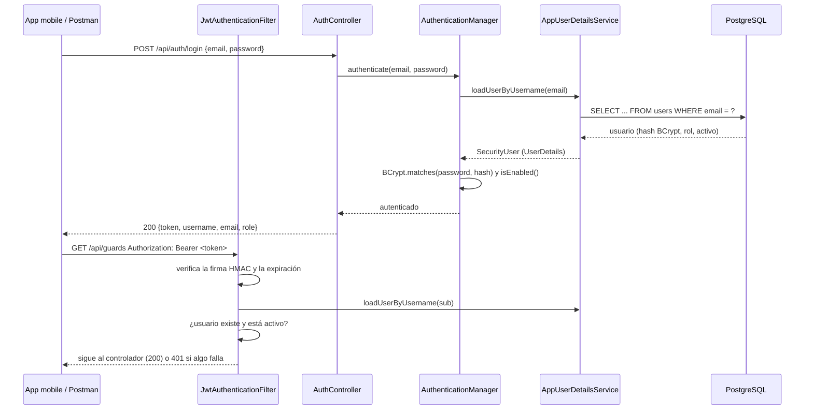

# Seguridad

Este documento explica cómo está implementada la autenticación y la autorización del backend, cómo se probó y qué análisis de seguridad se aplican.

## Autenticación con JWT

| Componente | Archivo | Qué hace |
|---|---|---|
| `SecurityConfig` | `shiftmanager/src/main/java/com/security/shiftmanager/config/SecurityConfig.java` | Define la `SecurityFilterChain`: sin sesión (`STATELESS`), CSRF desactivado (la API no usa cookies), reglas por ruta y rol, CORS, y respuesta 401 si falta autenticación |
| `PasswordEncoder` | mismo archivo, `@Bean passwordEncoder()` | BCrypt: las contraseñas se guardan como hash con salt; nunca en texto plano |
| `DaoAuthenticationProvider` / `AuthenticationManager` | mismo archivo | Comparan la contraseña recibida con el hash usando el `UserDetailsService` |
| `AppUserDetailsService` | `security/AppUserDetailsService.java` | Implementa `UserDetailsService`: busca el usuario por email en la base |
| `SecurityUser` | `security/SecurityUser.java` | Implementa `UserDetails`: adapta la entidad `User` (rol `ROLE_ADMIN` / `ROLE_SUPERVISOR`, `isEnabled()` = usuario activo) |
| `JwtService` | `security/JwtService.java` | Genera y valida tokens con jjwt 0.12.6. Firma HMAC-SHA (HS256/384/512 según el largo de `JWT_SECRET`) |
| `JwtAuthenticationFilter` | `security/JwtAuthenticationFilter.java` | `OncePerRequestFilter`: lee `Authorization: Bearer`, valida firma y expiración, y rechaza usuarios inexistentes o desactivados |
| `AuthController` | `controller/AuthController.java` | `POST /api/auth/login` y `GET /api/auth/me` |
| `UserRepository` / `User` | `repository/UserRepository.java`, `model/User.java` | Acceso a la tabla `users` |

### El token

- Contenido (payload): solo `sub` (email), `iat` (emitido) y `exp` (vence). No lleva la contraseña ni el rol: el rol se lee de la base en cada petición, así un cambio de rol o una desactivación tienen efecto inmediato.
- Firma: HMAC con `JWT_SECRET` (mínimo 32 caracteres; si es más corto, la app no arranca). Si alguien cambia un carácter del payload, la firma deja de coincidir y la petición recibe 401.
- Expiración: `JWT_EXPIRATION_MS` (24 h por defecto). Vencido = 401; la app mobile cierra la sesión y vuelve al login.
- No hay refresh token ni "Remember me": no es un requisito de la aplicación.

### Reglas de acceso

| Ruta | Acceso |
|---|---|
| `POST /api/auth/login`, `/hello`, Swagger | Público |
| `GET /actuator/health/**`, `GET /actuator/info` | Público (health checks de Docker y Azure) |
| `GET /api/auth/me` | Cualquier usuario autenticado |
| `GET /api/**` | ADMIN y SUPERVISOR |
| `POST/PUT/PATCH/DELETE /api/**` | Solo ADMIN |
| `/api/users/**`, `/actuator/metrics/**` | Solo ADMIN |

### Pruebas realizadas

Automáticas (`./gradlew test`): `AuthSecurityTest`, `RoleAccessTest`, `ActuatorAccessTest`.

De caja negra contra la aplicación corriendo con perfil `prod` y PostgreSQL 18 (17/17 OK):

| # | Prueba | Resultado esperado | Obtenido |
|---|---|---|---|
| 1 | Login correcto | 200 + token | 200 |
| 2 | Contraseña incorrecta / email inexistente | 401 con el mismo mensaje | 401 |
| 3 | Contenido del token | solo `sub`, `iat`, `exp` | OK |
| 4 | Payload alterado, firmado con otra clave, `alg: none` | 401 | 401 |
| 5 | Expiración | `exp - iat` = 86400 s | OK |
| 6 | Token vencido con firma válida | 401 | 401 |
| 6b | Token fabricado con el secreto real | 200 (prueba que la validación usa la clave) | 200 |
| 7-8 | Endpoint protegido con / sin token | 200 / 401 | OK |
| 9 | SUPERVISOR: leer / crear / usuarios / métricas | 200 / 403 / 403 / 403 | OK |
| 10 | Usuario autenticado (`/api/auth/me`) | datos del dueño del token, sin hash | OK |
| Extra | Token emitido antes de desactivar al usuario | 401 | 401 (corregido; antes daba 200) |
| Extra | Login con body vacío | 400 con detalle por campo | 400 |

Para repetirlas en Postman: importá `docs/postman/shiftmanager.postman_collection.json` y el environment `local` o `azure`, completá `adminPassword` en el environment y ejecutá la colección (botón **Run**).

## Anotaciones de Spring usadas en el proyecto

| Anotación | Dónde aparece | Para qué |
|---|---|---|
| `@Configuration` | `SecurityConfig`, `OpenApiConfig` | Clase que declara beans de configuración |
| `@Bean` | `SecurityConfig.passwordEncoder()`, `securityFilterChain()`, `corsConfigurationSource()` | El objeto que devuelve el método lo administra Spring y se inyecta donde se necesite. Por defecto es un singleton: hay un solo `PasswordEncoder` para toda la app |
| `@Component` | `JwtAuthenticationFilter`, `DataSeeder`, `DemoDataSeeder` | Spring detecta la clase y crea una instancia (bean) |
| `@Service` | `JwtService`, `AppUserDetailsService`, `GuardService`, etc. | Igual que `@Component`, marca la capa de lógica de negocio |
| `@Autowired` | Tests (`@Autowired MockMvc`) | Inyección por campo. En el código de producción se usa inyección por constructor (recomendada), que no necesita la anotación cuando hay un solo constructor |
| `@Entity` / `@Table` / `@Column` | `model/User.java`, `Guard`, `Service`, `ShiftAssignment` | Mapeo JPA de la clase a la tabla (`users`) y de los atributos a columnas (`nullable`, `unique`, `length`) |
| `@Transactional` | `service/*Service.java` (`readOnly = true` en las consultas), tests | La operación se ejecuta en una transacción: si falla, se hace rollback. En los tests, cada test se deshace al terminar |
| `@Override` | `SecurityUser` (métodos de `UserDetails`), `AppUserDetailsService.loadUserByUsername`, `JwtAuthenticationFilter.doFilterInternal` | Indica que se implementa un método de una interfaz o clase padre; el compilador verifica la firma |

Patrones que aparecen de forma natural (no se agregaron para demostrarlos):

- **Singleton**: todos los beans de Spring (`JwtService`, `PasswordEncoder`, servicios) tienen una sola instancia por aplicación.
- **Builder**: `Jwts.builder().subject(...).issuedAt(...).expiration(...).signWith(...).compact()` en `JwtService`, y `HttpSecurity` en `SecurityConfig`.
- **Chain of Responsibility**: la cadena de filtros de Spring Security (`SecurityFilterChain`), donde `JwtAuthenticationFilter` es un eslabón.

## Otras medidas

- **Inyección SQL**: todas las consultas son JPQL con parámetros (`@Param`) o métodos derivados de Spring Data (`findByEmail`); no hay SQL armado concatenando texto.
- **Validación de entrada**: Bean Validation (`@Valid`, `@NotBlank`, etc.) en los DTO; los errores devuelven 400 con el detalle por campo.
- **Errores**: `GlobalExceptionHandler` responde con un formato uniforme y sin stack traces.
- **Logs**: los logins exitosos y fallidos quedan registrados con el id de usuario y el motivo, nunca la contraseña ni el token.
- **Secretos**: en el perfil `prod` no hay valores por defecto; si falta uno la app no arranca. Ver `docs/azure.md` para dónde se guardan.
