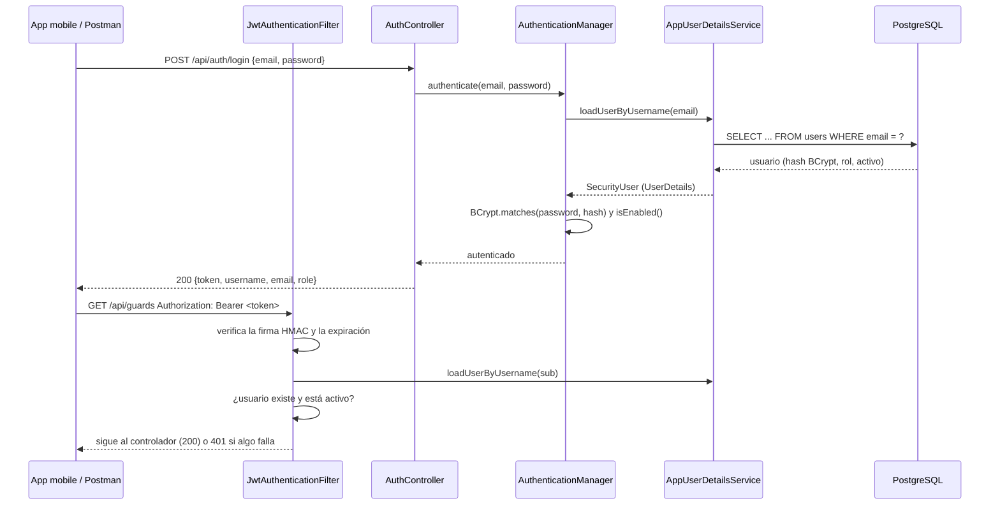

# Seguridad

Este documento explica cómo está implementada la autenticación y la autorización del backend, cómo se probó y qué análisis de seguridad se aplican.

## Autenticación con JWT



| Componente | Archivo | Qué hace |
|---|---|---|
| `SecurityConfig` | `shiftmanager/src/main/java/com/security/shiftmanager/config/SecurityConfig.java` | Define la `SecurityFilterChain`: sin sesión (`STATELESS`), CSRF desactivado (la API no usa cookies), reglas por ruta y rol, CORS, y respuesta 401 si falta autenticación |
| `PasswordEncoder` | mismo archivo, `@Bean passwordEncoder()` | BCrypt: las contraseñas se guardan como hash con salt; nunca en texto plano |
| `DaoAuthenticationProvider` / `AuthenticationManager` | mismo archivo | Comparan la contraseña recibida con el hash usando el `UserDetailsService` |
| `AppUserDetailsService` | `security/AppUserDetailsService.java` | Implementa `UserDetailsService`: busca el usuario por email en la base |
| `SecurityUser` | `security/SecurityUser.java` | Implementa `UserDetails`: adapta la entidad `User` (rol `ROLE_ADMIN` / `ROLE_SUPERVISOR`, `isEnabled()` = usuario activo) |
| `JwtService` | `security/JwtService.java` | Genera y valida tokens con jjwt 0.12.6. Firma HMAC-SHA (HS256/384/512 según el largo de `JWT_SECRET`) |
| `JwtAuthenticationFilter` | `security/JwtAuthenticationFilter.java` | `OncePerRequestFilter`: lee `Authorization: Bearer`, valida firma y expiración, y rechaza usuarios inexistentes o desactivados |
| `AuthController` | `controller/AuthController.java` | `POST /api/auth/login` y `GET /api/auth/me` |
| `UserRepository` / `User` | `repository/UserRepository.java`, `model/User.java` | Acceso a la tabla `users` |

### El token

- Contenido (payload): solo `sub` (email), `iat` (emitido) y `exp` (vence). No lleva la contraseña ni el rol: el rol se lee de la base en cada petición, así un cambio de rol o una desactivación tienen efecto inmediato.
- Firma: HMAC con `JWT_SECRET` (mínimo 32 caracteres; si es más corto, la app no arranca). Si alguien cambia un carácter del payload, la firma deja de coincidir y la petición recibe 401.
- Expiración: `JWT_EXPIRATION_MS` (24 h por defecto). Vencido = 401; la app mobile cierra la sesión y vuelve al login.
- No hay refresh token ni "Remember me": no es un requisito de la aplicación.

### Reglas de acceso

| Ruta | Acceso |
|---|---|
| `POST /api/auth/login`, `/hello`, Swagger | Público |
| `GET /actuator/health/**`, `GET /actuator/info` | Público (health checks de Docker y Azure) |
| `GET /api/auth/me` | Cualquier usuario autenticado |
| `GET /api/**` | ADMIN y SUPERVISOR |
| `POST/PUT/PATCH/DELETE /api/**` | Solo ADMIN |
| `/api/users/**`, `/actuator/metrics/**` | Solo ADMIN |

### Pruebas realizadas

Automáticas (`./gradlew test`): `AuthSecurityTest`, `RoleAccessTest`, `ActuatorAccessTest`.

De caja negra contra la aplicación corriendo con perfil `prod` y PostgreSQL 18 (17/17 OK):

| # | Prueba | Resultado esperado | Obtenido |
|---|---|---|---|
| 1 | Login correcto | 200 + token | 200 |
| 2 | Contraseña incorrecta / email inexistente | 401 con el mismo mensaje | 401 |
| 3 | Contenido del token | solo `sub`, `iat`, `exp` | OK |
| 4 | Payload alterado, firmado con otra clave, `alg: none` | 401 | 401 |
| 5 | Expiración | `exp - iat` = 86400 s | OK |
| 6 | Token vencido con firma válida | 401 | 401 |
| 6b | Token fabricado con el secreto real | 200 (prueba que la validación usa la clave) | 200 |
| 7-8 | Endpoint protegido con / sin token | 200 / 401 | OK |
| 9 | SUPERVISOR: leer / crear / usuarios / métricas | 200 / 403 / 403 / 403 | OK |
| 10 | Usuario autenticado (`/api/auth/me`) | datos del dueño del token, sin hash | OK |
| Extra | Token emitido antes de desactivar al usuario | 401 | 401 (corregido; antes daba 200) |
| Extra | Login con body vacío | 400 con detalle por campo | 400 |

Para repetirlas en Postman: importá `docs/postman/shiftmanager.postman_collection.json` y el environment `local` o `azure`, completá `adminPassword` en el environment y ejecutá la colección (botón **Run**).

## Anotaciones de Spring usadas en el proyecto

| Anotación | Dónde aparece | Para qué |
|---|---|---|
| `@Configuration` | `SecurityConfig`, `OpenApiConfig` | Clase que declara beans de configuración |
| `@Bean` | `SecurityConfig.passwordEncoder()`, `securityFilterChain()`, `corsConfigurationSource()` | El objeto que devuelve el método lo administra Spring y se inyecta donde se necesite. Por defecto es un singleton: hay un solo `PasswordEncoder` para toda la app |
| `@Component` | `JwtAuthenticationFilter`, `DataSeeder`, `DemoDataSeeder` | Spring detecta la clase y crea una instancia (bean) |
| `@Service` | `JwtService`, `AppUserDetailsService`, `GuardService`, etc. | Igual que `@Component`, marca la capa de lógica de negocio |
| `@Autowired` | Tests (`@Autowired MockMvc`) | Inyección por campo. En el código de producción se usa inyección por constructor (recomendada), que no necesita la anotación cuando hay un solo constructor |
| `@Entity` / `@Table` / `@Column` | `model/User.java`, `Guard`, `Service`, `ShiftAssignment` | Mapeo JPA de la clase a la tabla (`users`) y de los atributos a columnas (`nullable`, `unique`, `length`) |
| `@Transactional` | `service/*Service.java` (`readOnly = true` en las consultas), tests | La operación se ejecuta en una transacción: si falla, se hace rollback. En los tests, cada test se deshace al terminar |
| `@Override` | `SecurityUser` (métodos de `UserDetails`), `AppUserDetailsService.loadUserByUsername`, `JwtAuthenticationFilter.doFilterInternal` | Indica que se implementa un método de una interfaz o clase padre; el compilador verifica la firma |

Patrones que aparecen de forma natural (no se agregaron para demostrarlos):

- **Singleton**: todos los beans de Spring (`JwtService`, `PasswordEncoder`, servicios) tienen una sola instancia por aplicación.
- **Builder**: `Jwts.builder().subject(...).issuedAt(...).expiration(...).signWith(...).compact()` en `JwtService`, y `HttpSecurity` en `SecurityConfig`.
- **Chain of Responsibility**: la cadena de filtros de Spring Security (`SecurityFilterChain`), donde `JwtAuthenticationFilter` es un eslabón.

## Otras medidas

- **Inyección SQL**: todas las consultas son JPQL con parámetros (`@Param`) o métodos derivados de Spring Data (`findByEmail`); no hay SQL armado concatenando texto.
- **Validación de entrada**: Bean Validation (`@Valid`, `@NotBlank`, etc.) en los DTO; los errores devuelven 400 con el detalle por campo.
- **Errores**: `GlobalExceptionHandler` responde con un formato uniforme y sin stack traces.
- **Logs**: los logins exitosos y fallidos quedan registrados con el id de usuario y el motivo, nunca la contraseña ni el token.
- **Secretos**: en el perfil `prod` no hay valores por defecto; si falta uno la app no arranca. Ver `docs/azure.md` para dónde se guardan.

## Análisis de vulnerabilidades de la imagen (Grype)

### Conceptos

- **CVE** (Common Vulnerabilities and Exposures): identificador público de una vulnerabilidad conocida, por ejemplo `CVE-2026-5435`. GitHub publica además sus propios avisos con id `GHSA-xxxx` (muchos tienen un CVE asociado).
- **CVSS** (Common Vulnerability Scoring System): puntaje de 0 a 10 que mide la gravedad técnica (0.1-3.9 baja, 4-6.9 media, 7-8.9 alta, 9-10 crítica). No mide el riesgo para *nuestra* aplicación: una vulnerabilidad 9.8 en una función que no usamos no es explotable.
- **EPSS**: probabilidad estimada de que la vulnerabilidad se explote en los próximos 30 días (Grype la muestra en la columna `EPSS`).
- **Estado del fix**: `fixed` (hay versión corregida), `not-fixed` (todavía no hay), `wont-fix` (el mantenedor decidió no corregirla, normalmente por bajo impacto).

### Cómo se ejecuta

```powershell
grype docker:shiftmanager-backend:<tag>                              # informe completo
grype docker:shiftmanager-backend:<tag> --only-fixed --fail-on high  # regla del pipeline
```

La regla del pipeline (`--only-fixed --fail-on high`) hace fallar el build si hay alguna vulnerabilidad **alta o crítica que tiene corrección disponible**: es decir, algo que podemos y debemos arreglar. Las que no tienen corrección se reportan igual, pero no bloquean.

### Resultados (Grype 0.120.1, base de datos del 2026-10-19)

| Etapa | Imagen | Crítica | Alta | Media | Baja | Despreciable | **Total** | Altas/críticas corregibles |
|---|---|---|---|---|---|---|---|---|
| 1. Inicial | `eclipse-temurin:21-jre` (Ubuntu) + Spring Boot 3.5.13 | 9 | 31 | 173 | 23 | 0 | **236** | 38 (el pipeline fallaría) |
| 2. Cambio de imagen base | `distroless/java21-debian13:nonroot` + Spring Boot 3.5.13 | 8 | 44 | 51 | 13 | 19 | **135** | 31 |
| 3. Dependencias actualizadas | distroless + Spring Boot 3.5.16 + parches | **2** | 21 | 24 | 6 | 19 | **72** | **0** (el pipeline pasa) |

Informes completos: `docs/reports/grype-1-inicial.txt`, `grype-2-distroless.txt`, `grype-3-final.txt`.

> En la etapa 2 aumentan las "altas" porque Grype clasifica los paquetes de Debian con el CVSS de NVD, mientras que antes muchas de Ubuntu eran "medias". En total bajan de 236 a 135 y desaparecen las del binario Go `pebble` que traía la imagen de Ubuntu.

### Correcciones aplicadas

| Corrección | Archivo | Vulnerabilidades que resuelve (ejemplos) |
|---|---|---|
| Imagen base Ubuntu → distroless Debian 13 | `shiftmanager/Dockerfile` | Go stdlib en `/usr/bin/pebble`: GO-2026-6612 (crítica, CVSS 9.1) y 8 altas; ~120 de paquetes de Ubuntu |
| Spring Boot 3.5.13 → 3.5.16 | `shiftmanager/build.gradle` | spring-webmvc GHSA-x23c-287f-qqv5, spring-boot GHSA-wwpq-f5c3-7hvx, spring-data-commons, spring-expression, micrometer-core |
| Tomcat 10.1.53 → 10.1.61 | `build.gradle` (`ext['tomcat.version']`) | GHSA-9xv2-5v5q-p794 (CVE-2026-65905, crítica 9.8), GHSA-gcx9-497g-6cp6, GHSA-h3x4-894j-xpx5, GHSA-r29c-68gh-xp6x y otras |
| Jackson 2.21.2 → 2.21.7 | `build.gradle` (`ext['jackson-bom.version']`) | jackson-databind y jackson-core: 8 altas (CVSS 7.5-8.7) |
| Driver PostgreSQL 42.7.10 → 42.7.12 | `build.gradle` (`ext['postgresql.version']`) | GHSA-98qh-xjc8-98pq, GHSA-j92g-9f8w-j867 (alta 8.2) |
| log4j-api 2.24.3 → 2.25.5, commons-lang3 3.17.0 → 3.20.0 | `build.gradle` | GHSA-qv9r-c865-cp47, GHSA-j288-q9x7-2f5v (medias) |
| springdoc 2.8.9 → 2.8.17 | `build.gradle` | Mantenimiento dentro de la misma versión |

Todas son versiones de parche de la misma línea; después de cada cambio se ejecutaron los 31 tests y la colección de Postman contra la imagen.

### Vulnerabilidades pendientes y justificación

| Vulnerabilidad | Paquete | CVSS | Por qué queda | Riesgo para la app |
|---|---|---|---|---|
| GHSA-pc63-qcmh-9cmg (CVE-2026-47884) | spring-webmvc 6.2.19 | 9.8 | Sin parche en Spring Framework 6.2.x; corregido solo en 7.0.9 (requiere migrar a Spring Boot 4, cambio mayor) | **No explotable**: afecta a `XsltView`; la app es una API JSON y no usa vistas XSLT (verificado: 0 usos en el código) |
| GHSA-j9f9-w8pj-32f8 (CVE-2026-47890) | spring-webmvc 6.2.19 | 9.8 | Igual que la anterior | **No explotable**: afecta a Server-Sent Events con fragmentos; la app no usa SSE (0 usos) |
| 21 altas de Debian (glibc, gcc-14 runtime, zlib, util-linux) | paquetes base de distroless | 7.0-8.5 | Debian las marcó `won't fix` (20) o todavía sin parche (1) | Bajo: son librerías del sistema que la JVM carga pero sin herramientas de shell para explotarlas. Se resuelven solas al reconstruir cuando Debian publique el parche |

Acción a futuro: migrar a Spring Boot 4 (Spring Framework 7) elimina las dos críticas; no se hizo ahora porque es una versión mayor con cambios incompatibles y no corrige nada explotable en esta aplicación.

### Grype vs. Trivy

Se analizó la misma imagen con Trivy 0.76.0 (`docker run aquasec/trivy image shiftmanager-backend:<tag>`):

| | Grype | Trivy |
|---|---|---|
| Imagen inicial | 236 (9 críticas, 31 altas) | 135 (8 críticas, 26 altas) |
| Imagen final | 72 (2 críticas, 21 altas) | 64 (2 críticas, 4 altas) |

| Aspecto | Grype (Anchore) | Trivy (Aqua Security) |
|---|---|---|
| Qué analiza | Imágenes, directorios, SBOM | Imágenes, directorios, repos, IaC (Terraform, Dockerfile), secretos, licencias, Kubernetes |
| Severidad de paquetes del SO | CVSS de NVD | La que asigna la distribución (Debian/Ubuntu); por eso marca menos "altas" en Debian |
| SBOM | Usa Syft (mismo proveedor) | Integrado |
| Extra | EPSS y "risk" en la tabla | Detecta secretos y malas configuraciones |

Las dos herramientas coinciden en lo importante: las dos críticas de Spring MVC y que la imagen final no tiene nada corregible pendiente. Para el pipeline se usa Grype porque es la herramienta vista en clase.

## Análisis estático con CodeQL

Archivo: `.github/workflows/codeql.yml`. Resultados: repositorio → **Security** → **Code scanning**.

**Qué es**: CodeQL (GitHub) convierte el código fuente en una base de datos consultable y ejecuta consultas que buscan patrones de vulnerabilidades: datos que vienen del usuario y llegan sin validar a una consulta SQL, a un comando del sistema, a una ruta de archivo, a un log o a una respuesta HTML; uso de criptografía débil; deserialización insegura; secretos escritos en el código; y, en los workflows, inyección de expresiones `${{ }}` en scripts o permisos excesivos.

**Configuración**: Java (`build-mode: none`, analiza las fuentes sin compilar) y los workflows de GitHub Actions, con el conjunto de consultas `security-extended`. Corre en cada push y PR a `dev` y `main`, todos los lunes y a mano. Requiere el permiso `security-events: write` para subir los resultados (formato SARIF). En repositorios públicos es gratis; en privados requiere GitHub Code Security.

**Resultado** (CodeQL 2.27.2, 2026-10-20): 120 reglas de seguridad para Java y 23 para Actions, **0 hallazgos**. Era esperable por lo revisado a mano: las consultas a la base son JPQL con parámetros, las entradas se validan con Bean Validation y no se arman comandos, rutas ni HTML con datos del usuario.

> CodeQL **no bloquea ataques mientras la aplicación corre**: analiza el código antes de desplegarlo. La protección en ejecución contra inyección SQL la dan las consultas parametrizadas; CodeQL verifica que no haya consultas armadas con texto del usuario.

### Análisis estático vs. dependencias vs. imagen

| | CodeQL (SAST) | Análisis de dependencias | Grype / Trivy (imagen) |
|---|---|---|---|
| Qué mira | **Nuestro código** (`.java`, workflows) | Las librerías declaradas (`build.gradle`) | **Todo lo que hay dentro de la imagen**: paquetes del sistema operativo, JRE, jars |
| Qué encuentra | Errores de programación que crean vulnerabilidades (inyección, XSS, crypto débil) | CVE conocidos en versiones de librerías | CVE conocidos en cualquier paquete de la imagen |
| Ejemplo en este proyecto | Una consulta armada concatenando el texto de búsqueda (no hay) | `tomcat-embed-core 10.1.53` con CVE-2026-65905 | Lo anterior, más `libc6` de Debian o el binario Go `pebble` de Ubuntu |
| Cuándo corre | Push/PR y semanal | En el pipeline, al escanear la imagen | En el pipeline, después del `docker build` |
| Herramienta acá | `codeql.yml` | Grype (cataloga los jars) | Grype (pipeline), Trivy (comparación) |

Se complementan: Grype no puede saber si nuestro código tiene una inyección SQL, y CodeQL no sabe que la librería de Tomcat tiene un CVE.

## Revisión adicional

| Tema | Estado | Dónde |
|---|---|---|
| Validación de entradas | `@Valid` + Bean Validation en todos los `POST`/`PUT`; 400 con detalle por campo | `dto/*Request.java`, `GlobalExceptionHandler` |
| Consultas parametrizadas | Solo JPQL con `@Param` y métodos derivados | `repository/*` |
| Manejo de errores | Respuesta uniforme sin stack traces; 401/403/404/409/503 explícitos | `GlobalExceptionHandler`, `AuthController` |
| Información sensible | Actuator: detalle de health y métricas solo para ADMIN; logs sin contraseñas ni tokens; `/api/auth/me` sin hash | `SecurityConfig`, `application.properties` |
| Dependencias | Parches aplicados y control de Grype en el pipeline | `build.gradle`, `ci-cd.yml` |
| Dockerfile | Distroless sin shell, usuario 65532, sin secretos en capas, `.dockerignore` excluye `.env` y `.git` | `shiftmanager/Dockerfile` |
| Secretos | Sin valores por defecto en `prod`; GitHub Secrets / secrets de Container Apps; historial verificado con gitleaks (0 hallazgos) antes de hacer público el repositorio | `docs/azure.md` |
| Usuarios demo | El supervisor demo (contraseña publicada en el README) está desactivado en Azure | — |
